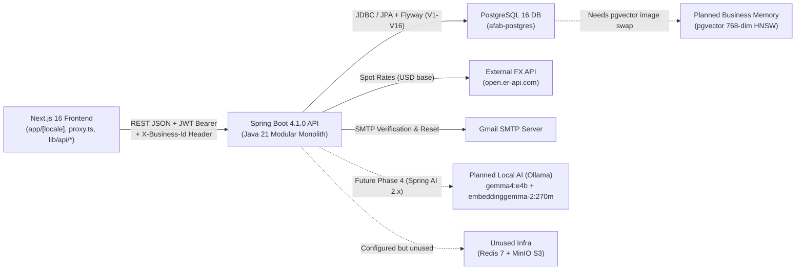

# AFAB — Complete Project Audit, Architecture Review & Technical Assessment

> **Audit Scope & Baseline:** Full static & cross-system audit of **AFAB (AI Finance Assistant for Business)** at commit `e9d22a3` in `C:\Users\moham\OneDrive\Bureau\projects\afab\AFAB` ([backend](file:///C:/Users/moham/OneDrive/Bureau/projects/afab/AFAB/project/backend/pom.xml), [frontend](file:///C:/Users/moham/OneDrive/Bureau/projects/afab/AFAB/project/frontend/package.json), [contracts](file:///C:/Users/moham/OneDrive/Bureau/projects/afab/AFAB/project/contracts/finance.openapi.yaml), [Context](file:///C:/Users/moham/OneDrive/Bureau/projects/afab/AFAB/project/Context/AFAB_AI_PROJECT_CONTEXT.md), [AI roadmap](file:///C:/Users/moham/OneDrive/Bureau/projects/afab/AFAB/project/AI%20roadmap/AFAB_AI_Features_Specification_v1.2.pdf), and Flyway migrations `V1`–`V16`). **No project files were modified**, and **zero real credentials, passwords, or personal emails are exposed** in this document.

---

## Quick Summary & Scorecard

| Metric | Result | Status | Plain-English Meaning |
|---|---|---|---|
| **Overall Readiness Score** | **72.9 / 100** (`+1.4` vs previous `71.5`) | 🟡 Solid Core | Strong UI/UX and ledger architecture, held back by security leaks and 3 unfinished backend modules. |
| **Security Posture** | **5.4 / 10** (`-0.4`) | 🔴 Needs Immediate Fix | Real Gmail SMTP credentials in `.env.example`, OTPs logged at `INFO`, and free `PRO` plan bypass. |
| **Frontend UI/UX & Integration** | **8.5 / 10** UI · **7.1 / 10** Integration | ✅ Mostly Connected | Clean bilingual (`en`/`ar` RTL) SaaS UI + new Settings modals work; Customers (`localStorage`) & AI route still need real backends. |
| **Database & Core Ledger** | **7.6 / 10** DB · **7.4 / 10** Backend | 🟡 Good With Bugs | `V1`–`V16` Flyway + `NUMERIC(19,4)` money types are solid; split-transaction queries, N+1 queries, and `findAll()` FX bug must be fixed. |
| **AI Assistant (Core Theme)** | **Spec Ready, Code 0%** | ❌ Not Built Yet | `/dashboard/ai` opens Pricing Plans. You now have a great local AI spec (`gemma4:e4b` + `pgvector`), ready to build in Phase 4. |

### Table of Contents
- [What Changed Since the Last Audit](#what-changed-since-the-last-audit)
- [System Architecture Diagram](#system-architecture-diagram)
- [PART 1 – Executive Summary](#part-1--executive-summary)
- [PART 2 – Project Structure Analysis](#part-2--project-structure-analysis)
- [PART 3 – Implementation Status](#part-3--implementation-status)
- [PART 4 – Critical Problems](#part-4--critical-problems)
- [PART 5 – Security Audit](#part-5--security-audit)
- [PART 6 – Architecture and Code Quality](#part-6--architecture-and-code-quality)
- [PART 7 – Missing Features and Requirements](#part-7--missing-features-and-requirements)
- [PART 8 – Frontend and Backend Integration](#part-8--frontend-and-backend-integration)
- [PART 9 – Database Assessment](#part-9--database-assessment)
- [PART 10 – Overall Project Score](#part-10--overall-project-score)
- [PART 11 – Prioritized Action Plan](#part-11--prioritized-action-plan)
- [PART 12 – Final Professional Verdict](#part-12--final-professional-verdict)
- [THE 10 MOST IMPORTANT THINGS WE MUST FIX OR COMPLETE IN AFAB](#the-10-most-important-things-we-must-fix-or-complete-in-afab)

---

## What Changed Since the Last Audit

> [!CAUTION]
> **URGENT ACTION REQUIRED — Real Gmail Credentials Committed in `project/.env.example` (Commit `d40afc2` — `fixing smtp`):**
> Real SMTP credentials — a live Gmail address in `MAIL_USERNAME` (line 33) and `MAIL_FROM` (line 38), plus a 16-letter Gmail App Password in `MAIL_PASSWORD` (line 36) — were committed directly into the tracked template file [.env.example](file:///C:/Users/moham/OneDrive/Bureau/projects/afab/AFAB/project/.env.example#L29-L38), right below the file's own warning comment stating that the repository is public and Google automatically revokes exposed App Passwords.
> **What to do right now:** (1) Open your Google Account → Security → App Passwords and **revoke that App Password immediately**; (2) replace lines 33, 36, and 38 in `.env.example` with generic placeholders (e.g., `your-email@gmail.com` / `your-16-char-app-password`); (3) keep real credentials only inside your untracked local `project/.env`; and (4) rewrite git history if this repo remains public on GitHub.

Here is the full summary of everything that changed in your latest commits (`102a73f` → `ebd4d0f` → `d40afc2` → `0c44496` → `7f31ef3` → `e9d22a3`):

1. **✅ Real Account Management & UI Fixes Landed (`0c44496`, merged in `e9d22a3`):**
   - **Edit Profile (`PUT /api/v1/user/me`):** Built [EditProfileModal.tsx](file:///C:/Users/moham/OneDrive/Bureau/projects/afab/AFAB/project/frontend/components/settings/EditProfileModal.tsx) (image compression/upload, preset avatars, name/phone update), wired live updates into [Sidebar.tsx](file:///C:/Users/moham/OneDrive/Bureau/projects/afab/AFAB/project/frontend/components/dashboard/Sidebar.tsx) (`afab_profile_updated` event), added unique phone conflict checks in [UserController.java](file:///C:/Users/moham/OneDrive/Bureau/projects/afab/AFAB/project/backend/src/main/java/com/afab/user/UserController.java#L66-L115), and created Flyway migration [V16__widen_avatar_url.sql](file:///C:/Users/moham/OneDrive/Bureau/projects/afab/AFAB/project/backend/src/main/resources/db/migration/V16__widen_avatar_url.sql) (`ALTER TABLE users ALTER COLUMN avatar_url TYPE TEXT`).
   - **GDPR-Style Data Export (`GET /api/v1/user/me/export`):** Implemented [UserAccountService.exportUserData](file:///C:/Users/moham/OneDrive/Bureau/projects/afab/AFAB/project/backend/src/main/java/com/afab/user/UserAccountService.java#L54-L207) using proper `LEFT JOIN FETCH` export queries (`findAllActiveByBusinessIdForExport`), cleanly excluding password hashes, 2FA secrets, backup codes, and refresh tokens, and logging an `ACCOUNT_DATA_EXPORTED` audit entry.
   - **GitHub-Style 3-Step Account Deletion (`DELETE /api/v1/user/me`):** Implemented [DeleteAccountModal.tsx](file:///C:/Users/moham/OneDrive/Bureau/projects/afab/AFAB/project/frontend/components/settings/DeleteAccountModal.tsx) and [UserAccountService.deleteUserAccount](file:///C:/Users/moham/OneDrive/Bureau/projects/afab/AFAB/project/backend/src/main/java/com/afab/user/UserAccountService.java#L214-L249) (breaks circular FK `users.active_business_id -> businesses.id` before PostgreSQL `ON DELETE CASCADE`).
   - **Next.js 16 & Hydration Cleanup:** Migrated `middleware.ts` → [proxy.ts](file:///C:/Users/moham/OneDrive/Bureau/projects/afab/AFAB/project/frontend/proxy.ts), fixed SSR hydration warnings in [Sidebar.tsx](file:///C:/Users/moham/OneDrive/Bureau/projects/afab/AFAB/project/frontend/components/dashboard/Sidebar.tsx#L73-L109) (`useSyncExternalStore`) and [dashboard/page.tsx](file:///C:/Users/moham/OneDrive/Bureau/projects/afab/AFAB/project/frontend/app/%5Blocale%5D/%28dashboard%29/dashboard/page.tsx#L104), improved RTL close button positioning in [dialog.tsx](file:///C:/Users/moham/OneDrive/Bureau/projects/afab/AFAB/project/frontend/components/ui/dialog.tsx#L68), and added `compact` mode / client-only clock init to [BinanceLiveChart.tsx](file:///C:/Users/moham/OneDrive/Bureau/projects/afab/AFAB/project/frontend/components/currencies/BinanceLiveChart.tsx).
   - **New Gaps Introduced by `0c44496`:**
     - `DELETE /api/v1/user/me` requires only `"delete <email>"` — **no current password or 2FA code check**, and [UserController.java](file:///C:/Users/moham/OneDrive/Bureau/projects/afab/AFAB/project/backend/src/main/java/com/afab/user/UserController.java#L159) repeats `.secure(false)` on the cleared cookie.
     - `PUT /api/v1/user/me` ([UpdateUserRequest.java](file:///C:/Users/moham/OneDrive/Bureau/projects/afab/AFAB/project/backend/src/main/java/com/afab/user/dto/UpdateUserRequest.java#L16-L17)) accepts any `avatarUrl` string up to 500,000 characters without checking the URI scheme or MIME type (`https://` or safe raster `data:image/jpeg|png|webp`).
     - `V16__widen_avatar_url.sql` widened `users.avatar_url`, **but `businesses.logo_url` is still `VARCHAR(500)`**, so business logo uploads still crash with HTTP 500. Also, since `V16` is now taken, the future Customers migration must be **`V17__customers.sql`** (not `V16`).
2. **✅ Huge Repository Cleanup (`ebd4d0f` — `remove files`):**
   - Deleted **101 obsolete/conflicting files** (`PRD/`, `New MD/`, `new md for frontend/`, `dark mode of AFAB/`, `light mode of  AFAB/`, root `package.json`, and root `package-lock.json`). The project directory is now much cleaner and easier to navigate.
3. **✅ Strong Local AI Specification Added (`102a73f` — `AI raodmap`):**
   - Added [AFAB_AI_Features_Specification_v1.2.pdf](file:///C:/Users/moham/OneDrive/Bureau/projects/afab/AFAB/project/AI%20roadmap/AFAB_AI_Features_Specification_v1.2.pdf) (23 pages). It defines a realistic, privacy-first local AI stack (**Ollama** running **`gemma4:e4b`** + **`embeddinggemma-2:270m`** + **PostgreSQL `pgvector`** HNSW 768-dim index + **Spring AI 2.x**) across 6 coordinated features (Pulse, Business Memory, Copilot supporting Tunisian Derja/Arabizi/French/English, Decision Lab, Financial Health Guardian, Currency Intelligence), where **Java `BigDecimal` owns all math** and AI never modifies data without human confirmation.
   - *Important infra note:* [docker-compose.yml](file:///C:/Users/moham/OneDrive/Bureau/projects/afab/AFAB/project/docker-compose.yml#L4) currently uses stock `postgres:16-alpine` (without `pgvector`), so it must switch to a `pgvector`-enabled Postgres 16 image before storing embeddings.
4. **🟡 Email Verification Dev Helper Hidden (`7f31ef3` — `dev otp`):**
   - Commented out the visible dev-OTP auto-fill box in [verify-email/page.tsx](file:///C:/Users/moham/OneDrive/Bureau/projects/afab/AFAB/project/frontend/app/%5Blocale%5D/%28auth%29/verify-email/page.tsx#L294-L317). However, the `devOtp` state/listener (lines 27, 172–174) remains in React, [AuthService.java](file:///C:/Users/moham/OneDrive/Bureau/projects/afab/AFAB/project/backend/src/main/java/com/afab/auth/AuthService.java#L163-L165) & [AuthController.java](file:///C:/Users/moham/OneDrive/Bureau/projects/afab/AFAB/project/backend/src/main/java/com/afab/auth/AuthController.java#L277-L279) still return `devOtp` in JSON under `local`/`dev` profiles, and [SmtpEmailServiceImpl.java](file:///C:/Users/moham/OneDrive/Bureau/projects/afab/AFAB/project/backend/src/main/java/com/afab/mail/SmtpEmailServiceImpl.java#L59) still logs raw OTPs in server logs.

---

## System Architecture Diagram



---

## PART 1 – Executive Summary

### 1. What AFAB Currently Is
**AFAB (AI Finance Assistant for Business)** is a bilingual (`en` / `ar` RTL) SaaS financial platform built with a **Spring Boot 4.1.0 (Java 21)** modular monolith backend, a **Next.js 16.2.10 (React 19, TypeScript, Tailwind CSS v4)** App Router frontend, and a **PostgreSQL 16** database managed with **Flyway (`V1`–`V16`)**.

### 2. What Actually Works End-to-End Today
- **Authentication, 2FA & Account Lifecycle:** Sign-up, login, BCrypt(12) password hashing, 5-attempt lockout (15-minute cooldown), TOTP Two-Factor Authentication with SHA-256 backup codes, email OTP verification, password reset (OTP + URL link), active session management, and the **newly added Profile Editor (`PUT /api/v1/user/me`), GDPR JSON Export (`GET /api/v1/user/me/export`), and Account Deletion (`DELETE /api/v1/user/me`)** ([AuthController.java](file:///C:/Users/moham/OneDrive/Bureau/projects/afab/AFAB/project/backend/src/main/java/com/afab/auth/AuthController.java), [UserController.java](file:///C:/Users/moham/OneDrive/Bureau/projects/afab/AFAB/project/backend/src/main/java/com/afab/user/UserController.java)).
- **Multi-Business Isolation:** Businesses and memberships (`V13__business_members.sql`) resolve tenant ownership server-side via the `X-Business-Id` header in [CurrentBusinessService.java](file:///C:/Users/moham/OneDrive/Bureau/projects/afab/AFAB/project/backend/src/main/java/com/afab/business/CurrentBusinessService.java).
- **Core Ledger & Categories:** Create/read/update/soft-delete transactions and categories using `NUMERIC(19,4)` money columns, tax flags, multi-category splits (`V11`), and category delete protection (`409 Conflict` when in use) ([TransactionService.java](file:///C:/Users/moham/OneDrive/Bureau/projects/afab/AFAB/project/backend/src/main/java/com/afab/finance/service/TransactionService.java)).
- **Dashboard, Expenses, Revenue & Reports:** Real SQL cash-basis calculations (`COMPLETED` transactions), Profit & Loss, Cash Flow, Period Comparison, CSV export, and OpenPDF PDF download ([FinanceStatsService.java](file:///C:/Users/moham/OneDrive/Bureau/projects/afab/AFAB/project/backend/src/main/java/com/afab/finance/stats/FinanceStatsService.java), [ReportService.java](file:///C:/Users/moham/OneDrive/Bureau/projects/afab/AFAB/project/backend/src/main/java/com/afab/reports/service/ReportService.java)).
- **Subscription Snapshot & Trial Tracking (Backend):** Plan quotas, 7-day trials, and trial expiration reconciliation exist in PostgreSQL (`V15`) and [EntitlementService.java](file:///C:/Users/moham/OneDrive/Bureau/projects/afab/AFAB/project/backend/src/main/java/com/afab/subscription/EntitlementService.java).

### 3. What Is Only Partially Working
- **Customers Page:** Beautiful frontend UI ([customers/page.tsx](file:///C:/Users/moham/OneDrive/Bureau/projects/afab/AFAB/project/frontend/app/%5Blocale%5D/%28dashboard%29/dashboard/customers/page.tsx)), **zero backend**. [lib/api/customers.ts](file:///C:/Users/moham/OneDrive/Bureau/projects/afab/AFAB/project/frontend/lib/api/customers.ts#L256-L626) catches 404s from `/api/v1/customers` and quietly saves customer records in browser `localStorage`.
- **Invoices Page:** Backend [InvoiceController.java](file:///C:/Users/moham/OneDrive/Bureau/projects/afab/AFAB/project/backend/src/main/java/com/afab/finance/controller/InvoiceController.java) is just an alias over `INCOME` transactions (no `invoices` table, ignores `period`, caps at 100 rows, counts `CANCELLED` as `Overdue`, never deducts `invoices.per_month` quota).
- **Currencies & Live Market Chart:** Spot FX rates come live from `open.er-api.com`, while 24h changes, 7-day sparklines, historical trajectories, and 1-second Binance candles/trades are mathematical simulations (`Math.sin`), and FX rate alerts only save to `localStorage` ([ExchangeRateService.java](file:///C:/Users/moham/OneDrive/Bureau/projects/afab/AFAB/project/backend/src/main/java/com/afab/finance/currency/ExchangeRateService.java#L94-L160), [BinanceLiveChart.tsx](file:///C:/Users/moham/OneDrive/Bureau/projects/afab/AFAB/project/frontend/components/currencies/BinanceLiveChart.tsx)).
- **Calendar & Settings Subpages:** Calendar fetches only the latest 100 transactions without month bounds; Settings tabs `Users & Permissions`, `Notifications`, `Integrations`, `Data & Export`, `Appearance`, and `Language` still render "Coming Soon" ([settings/[...slug]/page.tsx](file:///C:/Users/moham/OneDrive/Bureau/projects/afab/AFAB/project/frontend/app/%5Blocale%5D/%28dashboard%29/dashboard/settings/%5B...slug%5D/page.tsx)).

### 4. What Is Missing
- **AI Assistant Implementation:** `/dashboard/ai` renders `<PlansScreen />` ([ai/page.tsx](file:///C:/Users/moham/OneDrive/Bureau/projects/afab/AFAB/project/frontend/app/%5Blocale%5D/%28dashboard%29/dashboard/ai/page.tsx)). No Spring AI / Ollama integration or chat endpoint exists yet, though [AFAB_AI_Features_Specification_v1.2.pdf](file:///C:/Users/moham/OneDrive/Bureau/projects/afab/AFAB/project/AI%20roadmap/AFAB_AI_Features_Specification_v1.2.pdf) now gives the exact blueprint.
- **Real File Storage & Payment Verification:** `MinIO` and `Redis` exist in Docker and `pom.xml`, yet neither is used in Java code; `POST /api/v1/subscription/switch` grants free `PRO` upgrades without payment verification.

---

## PART 2 – Project Structure Analysis

### Clean Repository Tree (After Cleanup `ebd4d0f` & Merge `e9d22a3`)

```text
AFAB/
├── .idea/                                    # Minor leftover IDE settings (recommended to untrack)
└── project/
    ├── .env.example                          # ⚠️ URGENT: Contains real Gmail SMTP credentials on lines 33, 36, 38
    ├── docker-compose.yml                    # Postgres 16 (needs pgvector later), MinIO (unused), Redis 7 (unused), Backend
    ├── package-lock.json                     # Minor leftover root/project lockfile
    ├── AFAB_Master_Roadmap.md                # Master phase roadmap
    ├── AI roadmap/
    │   └── AFAB_AI_Features_Specification_v1.2.pdf  # Privacy-first local AI spec (gemma4:e4b + pgvector + Spring AI)
    ├── Context/                              # AI/dev context docs (contains minor drift vs actual code)
    ├── contracts/                            # 4 OpenAPI YAML specs (missing ~15 implemented endpoints)
    ├── backend/                              # Spring Boot 4.1.0 (Java 21) modular monolith
    │   ├── pom.xml
    │   ├── src/main/java/com/afab/           # auth, business, common, config, dashboard, finance, health, mail, reports, security, subscription, user
    │   ├── src/main/resources/db/migration/  # Flyway V1..V16 (V16__widen_avatar_url.sql)
    │   └── src/test/java/com/afab/           # 9 Mockito unit test classes
    └── frontend/                             # Next.js 16.2.10 App Router + Tailwind CSS v4
        ├── proxy.ts                          # Next 16 auth + next-intl route proxy (replaces middleware.ts)
        ├── eslint-report.json                # Minor leftover lint artifact
        ├── app/[locale]/                     # (auth) and (dashboard) routes in /en and /ar
        ├── components/                       # 62 ui primitives + feature components (settings, plans, currencies, dashboard)
        ├── lib/                              # api/* clients, auth-store, currency, nlp-transaction-parser
        └── messages/                         # English & Arabic translation JSONs
```

### Remaining Structural Clutter & Unused Infrastructure
1. **Minor Leftover Files:** `.idea/`, [project/package-lock.json](file:///C:/Users/moham/OneDrive/Bureau/projects/afab/AFAB/project/package-lock.json), and `project/frontend/eslint-report.json` sit alongside [frontend/package-lock.json](file:///C:/Users/moham/OneDrive/Bureau/projects/afab/AFAB/project/frontend/package-lock.json).
2. **Three Duplicate `<PlansScreen />` Routes:** `/dashboard/ai` ([ai/page.tsx](file:///C:/Users/moham/OneDrive/Bureau/projects/afab/AFAB/project/frontend/app/%5Blocale%5D/%28dashboard%29/dashboard/ai/page.tsx)), `/dashboard/plans` ([plans/page.tsx](file:///C:/Users/moham/OneDrive/Bureau/projects/afab/AFAB/project/frontend/app/%5Blocale%5D/%28dashboard%29/dashboard/plans/page.tsx)), and `/dashboard/upgrade` ([upgrade/page.tsx](file:///C:/Users/moham/OneDrive/Bureau/projects/afab/AFAB/project/frontend/app/%5Blocale%5D/%28dashboard%29/dashboard/upgrade/page.tsx)) all render the exact same component.
3. **Unused Containers & Java Libraries:** [pom.xml](file:///C:/Users/moham/OneDrive/Bureau/projects/afab/AFAB/project/backend/pom.xml#L88-L114) and [docker-compose.yml](file:///C:/Users/moham/OneDrive/Bureau/projects/afab/AFAB/project/docker-compose.yml#L22-L56) configure **Redis 7** and **MinIO**, plus `KycVerification.java` (`kyc_verifications`), **but zero Java code uses Redis, MinIO, or `KycVerification`**.
4. **~55 Unused UI Primitives:** `project/frontend/components/ui/` contains 62 shadcn/Base UI files, most unused (harmless cleanly organized files, though cleanup helps).

---

## PART 3 – Implementation Status

| Feature | Status | Evidence / Location | What Is Missing or Broken |
|---|---|---|---|
| **Authentication** | **Implemented but Problematic** | [AuthController.java](file:///C:/Users/moham/OneDrive/Bureau/projects/afab/AFAB/project/backend/src/main/java/com/afab/auth/AuthController.java), [AuthService.java](file:///C:/Users/moham/OneDrive/Bureau/projects/afab/AFAB/project/backend/src/main/java/com/afab/auth/AuthService.java), [JwtService.java](file:///C:/Users/moham/OneDrive/Bureau/projects/afab/AFAB/project/backend/src/main/java/com/afab/auth/security/JwtService.java), [SmtpEmailServiceImpl.java](file:///C:/Users/moham/OneDrive/Bureau/projects/afab/AFAB/project/backend/src/main/java/com/afab/mail/SmtpEmailServiceImpl.java) | Plaintext OTPs/reset links logged at `INFO`; `java.util.Random` for OTPs; single global rate-limit bucket (auth DoS risk); unhashed refresh tokens & plaintext 2FA secrets in DB; no rate limit on `/2fa/verify-login` or `/verify-email`; old JWTs survive password change. |
| **Dashboard** | **Partially Implemented** | [DashboardController.java](file:///C:/Users/moham/OneDrive/Bureau/projects/afab/AFAB/project/backend/src/main/java/com/afab/dashboard/DashboardController.java), [FinanceStatsService.java#L87-L88](file:///C:/Users/moham/OneDrive/Bureau/projects/afab/AFAB/project/backend/src/main/java/com/afab/finance/stats/FinanceStatsService.java#L87-L88), [dashboard/page.tsx](file:///C:/Users/moham/OneDrive/Bureau/projects/afab/AFAB/project/frontend/app/%5Blocale%5D/%28dashboard%29/dashboard/page.tsx) | `reminders` and `customers` return empty `List.of()`; split child categories disappear into `"Uncategorized"`; `AIInsightsCard` is rule-based template strings. |
| **Transactions** | **Implemented but Problematic** | [TransactionController.java](file:///C:/Users/moham/OneDrive/Bureau/projects/afab/AFAB/project/backend/src/main/java/com/afab/finance/controller/TransactionController.java), [TransactionService.java](file:///C:/Users/moham/OneDrive/Bureau/projects/afab/AFAB/project/backend/src/main/java/com/afab/finance/service/TransactionService.java), [transactions/page.tsx](file:///C:/Users/moham/OneDrive/Bureau/projects/afab/AFAB/project/frontend/app/%5Blocale%5D/%28dashboard%29/dashboard/transactions/page.tsx) | Up to 201+ SQL queries per 100 rows (`mapToDTO` N+1 loop); KPI cards sum `CANCELLED`/`PENDING` rows across all time; editing ignores `splitItems`; deleting ignores `splitItems` (locking categories). |
| **Expenses** | **Partially Implemented** | [ExpenseController.java](file:///C:/Users/moham/OneDrive/Bureau/projects/afab/AFAB/project/backend/src/main/java/com/afab/finance/controller/ExpenseController.java), [FinanceStatsService.java#L164-L169](file:///C:/Users/moham/OneDrive/Bureau/projects/afab/AFAB/project/backend/src/main/java/com/afab/finance/stats/FinanceStatsService.java#L164-L169), [expenses/page.tsx](file:///C:/Users/moham/OneDrive/Bureau/projects/afab/AFAB/project/frontend/app/%5Blocale%5D/%28dashboard%29/dashboard/expenses/page.tsx) | `recurringTotal`, `recurringPercentage`, and `recurringList` are hardcoded `0`/empty; split expense child categories missing from breakdown; expense table query ignores selected period. |
| **Revenue** | **Partially Implemented** | [RevenueController.java](file:///C:/Users/moham/OneDrive/Bureau/projects/afab/AFAB/project/backend/src/main/java/com/afab/finance/controller/RevenueController.java), [FinanceStatsService.java#L236-L246](file:///C:/Users/moham/OneDrive/Bureau/projects/afab/AFAB/project/backend/src/main/java/com/afab/finance/stats/FinanceStatsService.java#L236-L246), [revenue/page.tsx](file:///C:/Users/moham/OneDrive/Bureau/projects/afab/AFAB/project/frontend/app/%5Blocale%5D/%28dashboard%29/dashboard/revenue/page.tsx) | `discounts`, `refunds`, and `topProducts` are hardcoded `0`/empty; `grossRevenue` equals `netRevenue`; revenue table query ignores selected period. |
| **Invoices** | **Implemented but Problematic** | [InvoiceController.java](file:///C:/Users/moham/OneDrive/Bureau/projects/afab/AFAB/project/backend/src/main/java/com/afab/finance/controller/InvoiceController.java), [TransactionService.java#L320-L384](file:///C:/Users/moham/OneDrive/Bureau/projects/afab/AFAB/project/backend/src/main/java/com/afab/finance/service/TransactionService.java#L320-L384), [invoices/page.tsx#L123-L135](file:///C:/Users/moham/OneDrive/Bureau/projects/afab/AFAB/project/frontend/app/%5Blocale%5D/%28dashboard%29/dashboard/invoices/page.tsx#L123-L135) | Alias over `INCOME` transactions (no `invoices` table); ignores `period`; caps at 100 rows; counts `CANCELLED` as `Overdue`; never consumes `invoices.per_month` quota; hardcoded sparkline array prefixes. |
| **Customers** | **Partially Implemented** | [customers/page.tsx](file:///C:/Users/moham/OneDrive/Bureau/projects/afab/AFAB/project/frontend/app/%5Blocale%5D/%28dashboard%29/dashboard/customers/page.tsx), [customers.ts#L256-L626](file:///C:/Users/moham/OneDrive/Bureau/projects/afab/AFAB/project/frontend/lib/api/customers.ts#L256-L626) | **Frontend only — Backend Not Implemented.** No `customers` migration/entity/controller; `/api/v1/customers` 404s and silently stores data in `localStorage`. |
| **Reports** | **Fully Implemented** | [ReportController.java](file:///C:/Users/moham/OneDrive/Bureau/projects/afab/AFAB/project/backend/src/main/java/com/afab/reports/controller/ReportController.java), [ReportService.java#L285](file:///C:/Users/moham/OneDrive/Bureau/projects/afab/AFAB/project/backend/src/main/java/com/afab/reports/service/ReportService.java#L285), [CsvReportExporter.java](file:///C:/Users/moham/OneDrive/Bureau/projects/afab/AFAB/project/backend/src/main/java/com/afab/reports/service/CsvReportExporter.java), [PdfReportExporter.java](file:///C:/Users/moham/OneDrive/Bureau/projects/afab/AFAB/project/backend/src/main/java/com/afab/reports/service/PdfReportExporter.java) | Minor fixes needed: sanitize CSV formulas (`=`, `+`, `-`, `@`), return real `COUNT(t)` instead of hardcoded `1`, and embed an Arabic font in `PdfReportExporter` (`HELVETICA` drops Arabic letters). |
| **AI Assistant** | **Not Implemented** | [ai/page.tsx](file:///C:/Users/moham/OneDrive/Bureau/projects/afab/AFAB/project/frontend/app/%5Blocale%5D/%28dashboard%29/dashboard/ai/page.tsx), [AFAB_AI_Features_Specification_v1.2.pdf](file:///C:/Users/moham/OneDrive/Bureau/projects/afab/AFAB/project/AI%20roadmap/AFAB_AI_Features_Specification_v1.2.pdf) | Route renders `<PlansScreen />`; `AIInsightsCard` and `QuickAddBar` are non-AI rule logic; v1.2 local AI blueprint (`gemma4:e4b` + `pgvector` + Spring AI 2.x) is ready to build. |
| **Subscriptions** | **Implemented but Problematic** | [SubscriptionController.java#L45-L52](file:///C:/Users/moham/OneDrive/Bureau/projects/afab/AFAB/project/backend/src/main/java/com/afab/subscription/SubscriptionController.java#L45-L52), [EntitlementService.java#L248-L267](file:///C:/Users/moham/OneDrive/Bureau/projects/afab/AFAB/project/backend/src/main/java/com/afab/subscription/EntitlementService.java#L248-L267), [PlansScreen.tsx#L462](file:///C:/Users/moham/OneDrive/Bureau/projects/afab/AFAB/project/frontend/components/plans/PlansScreen.tsx#L462) | Anyone can call `POST /api/v1/subscription/switch` for free `PRO`; `BusinessController` checks stale `user.getPlanTier()`; frontend reads `isTrial` while backend sends `"trial"` (breaking trial banner). |
| **Database** | **Partially Implemented** | [V1__init.sql](file:///C:/Users/moham/OneDrive/Bureau/projects/afab/AFAB/project/backend/src/main/resources/db/migration/V1__init.sql) through [V16__widen_avatar_url.sql](file:///C:/Users/moham/OneDrive/Bureau/projects/afab/AFAB/project/backend/src/main/resources/db/migration/V16__widen_avatar_url.sql) | `V1`–`V16` are clean (`V16` fixed `users.avatar_url`); still missing `customers` (`V17`), `invoices`, `businesses.logo_url` widening, and `pgvector` tables for AI memory. |

*(Bonus recent addition in `0c44496`: **User Account Management — Edit Profile, GDPR Data Export, Permanent Delete** is **Implemented** end-to-end across `UserController`, `UserAccountService`, `V16`, and `GeneralSettings` modals, needing only a password/2FA confirmation check on deletion and `avatarUrl` scheme validation.)*

---

## PART 4 – Critical Problems

Here is every high-impact issue explained in plain English so it is easy to prioritize and fix:

### C1 — Real Gmail Credentials Committed in `.env.example` — **P0 (Critical)**
- **What's wrong:** Tracked template file `project/.env.example` contains a real Gmail address and a real 16-letter Gmail App Password.
- **Where:** [.env.example](file:///C:/Users/moham/OneDrive/Bureau/projects/afab/AFAB/project/.env.example#L33-L38) (lines 33, 36, 38).
- **Why it matters:** Anyone cloning or viewing the repository gets SMTP access to that Gmail account, and GitHub secret scanning / Google automatically revokes exposed App Passwords, breaking your verification emails.
- **How to fix:** Revoke the App Password in Google Account immediately, replace lines 33/36/38 with placeholder text, keep real credentials only in untracked `project/.env`, and scrub git history if public.

### C2 — Plaintext Verification Codes & Reset Links Written to Logs — **P0 (Critical)**
- **What's wrong:** Whenever AFAB emails a 6-digit verification code or password-reset link, it prints the secret code/link straight into server `INFO` logs.
- **Where:** [SmtpEmailServiceImpl.java#L59](file:///C:/Users/moham/OneDrive/Bureau/projects/afab/AFAB/project/backend/src/main/java/com/afab/mail/SmtpEmailServiceImpl.java#L59), [#L90](file:///C:/Users/moham/OneDrive/Bureau/projects/afab/AFAB/project/backend/src/main/java/com/afab/mail/SmtpEmailServiceImpl.java#L90), [#L106](file:///C:/Users/moham/OneDrive/Bureau/projects/afab/AFAB/project/backend/src/main/java/com/afab/mail/SmtpEmailServiceImpl.java#L106), while [application.yml#L107](file:///C:/Users/moham/OneDrive/Bureau/projects/afab/AFAB/project/backend/src/main/resources/application.yml#L107) sets `com.afab: INFO`.
- **Why it matters:** Anyone reading Docker/host logs can hijack any account even though OTPs are hashed in PostgreSQL.
- **How to fix:** Remove `otpCode` and `link` from all `log.info(...)` lines (log only masked recipient + status).

### C3 — Free Upgrade to `PRO` & Stale Trial Limits on Business Creation — **P0 (Critical)**
- **What's wrong:** Any logged-in user can call `POST /api/v1/subscription/switch` with `"pro"` and instantly become an active Pro subscriber with zero payment check. Meanwhile, creating extra businesses checks `user.getPlanTier()` directly instead of reconciling expired 7-day trials first.
- **Where:** [SubscriptionController.java#L45-L52](file:///C:/Users/moham/OneDrive/Bureau/projects/afab/AFAB/project/backend/src/main/java/com/afab/subscription/SubscriptionController.java#L45-L52), [EntitlementService.java#L248-L267](file:///C:/Users/moham/OneDrive/Bureau/projects/afab/AFAB/project/backend/src/main/java/com/afab/subscription/EntitlementService.java#L248-L267), [BusinessController.java#L74-L96](file:///C:/Users/moham/OneDrive/Bureau/projects/afab/AFAB/project/backend/src/main/java/com/afab/business/BusinessController.java#L74-L96).
- **Why it matters:** Complete bypass of your SaaS billing model and business workspace limits.
- **How to fix:** Guard `/switch` behind `@Profile({"local", "dev"})` (or verified checkout/admin role), and make `BusinessController` call `EntitlementService.check(email, "business.max")`.

### C4 — Changing Base Currency Loads Every User's Transactions Into RAM (`findAll()`) — **P0 (Critical)**
- **What's wrong:** `changeBusinessCurrency` fetches **every row across every company in the entire database** with `transactionRepository.findAll()` and filters by `business.getId()` in Java.
- **Where:** [CurrencyConversionService.java#L75-L77](file:///C:/Users/moham/OneDrive/Bureau/projects/afab/AFAB/project/backend/src/main/java/com/afab/finance/currency/CurrencyConversionService.java#L75-L77).
- **Why it matters:** Severe multi-tenant memory exposure and eventual `OutOfMemoryError` crash as data grows.
- **How to fix:** Add a tenant-scoped repository query (`findAllActiveByBusinessIdForExport` already exists in `TransactionRepository`, or add `findByBusinessIdAndDeletedAtIsNull`) and reconcile parent split amounts from converted children.

### C5 — N+1 SQL Query Storm on the Transactions Page (Up to 300+ Queries/Page) — **P1 (High)**
- **What's wrong:** Fetching 100 transactions runs a loop (`mapToDTO`) that executes 2 extra anomaly SQL queries per row (`findPotentialDuplicates` + `findPastExpensesByDescription`), plus lazy-loads `category` because `searchTransactions` lacks `LEFT JOIN FETCH t.category`.
- **Where:** [TransactionService.java#L432-L460](file:///C:/Users/moham/OneDrive/Bureau/projects/afab/AFAB/project/backend/src/main/java/com/afab/finance/service/TransactionService.java#L432-L460), [TransactionRepository.java#L21-L32](file:///C:/Users/moham/OneDrive/Bureau/projects/afab/AFAB/project/backend/src/main/java/com/afab/finance/repository/TransactionRepository.java#L21-L32).
- **Why it matters:** One page view hammers PostgreSQL with 201–300+ queries instead of 1–3 queries.
- **How to fix:** Add `LEFT JOIN FETCH t.category` to `searchTransactions` and compute/persist duplicate/anomaly flags on write (or run one batched query per page).

### C6 — Customers Data Only Lives in Browser `localStorage` — **P1 (High)**
- **What's wrong:** Every call to `/api/v1/customers` gets a 404 from Spring Boot because no backend Customer entity/controller exists, so the frontend catches the error and saves customers in browser `localStorage`. Meanwhile, [AFAB_BACKEND_CONTEXT.md#L128](file:///C:/Users/moham/OneDrive/Bureau/projects/afab/AFAB/project/Context/AFAB_BACKEND_CONTEXT.md#L128) mistakenly claims `V16__customers.sql` is planned/built (`V16` was actually used by `V16__widen_avatar_url.sql`).
- **Where:** [customers.ts#L256-L626](file:///C:/Users/moham/OneDrive/Bureau/projects/afab/AFAB/project/frontend/lib/api/customers.ts#L256-L626), [FinanceStatsService.java#L88](file:///C:/Users/moham/OneDrive/Bureau/projects/afab/AFAB/project/backend/src/main/java/com/afab/finance/stats/FinanceStatsService.java#L88).
- **Why it matters:** Clearing cookies/cache or logging in on another computer erases all customers, and the Dashboard `Top Customers` widget stays permanently empty.
- **How to fix:** Create `V17__customers.sql`, `Customer` & `CustomerOrder` JPA entities/services/controller (`/api/v1/customers`), wire `FinanceStatsService` to real top customers, and remove the `localStorage` fallback.

### C7 — Invoices Page Is Faked Over `INCOME` Transactions With Broken Math — **P1 (High)**
- **What's wrong:**
  1. `getInvoiceSummary(userEmail, period)` ignores `period` completely (switching Week/Month/Year does nothing).
  2. It only reads the first 100 `INCOME` rows (`PageRequest.of(0, 100)`) and loops in Java.
  3. Non-`COMPLETED`/`PENDING` transactions — including **`CANCELLED`** ones — fall into `else` and get counted as **`Overdue` invoices**!
  4. It never enforces `invoices.per_month`, returns empty `upcomingList`, and [invoices/page.tsx#L123-L135](file:///C:/Users/moham/OneDrive/Bureau/projects/afab/AFAB/project/frontend/app/%5Blocale%5D/%28dashboard%29/dashboard/invoices/page.tsx#L123-L135) prepends hardcoded numbers (`[2, 4, 3, 6, 4, ...]`, `[1, 2, 4, 3, ...]`, `[3, 2, 4, ...]`) to sparkline charts.
- **Where:** [TransactionService.java#L320-L384](file:///C:/Users/moham/OneDrive/Bureau/projects/afab/AFAB/project/backend/src/main/java/com/afab/finance/service/TransactionService.java#L320-L384), [InvoiceController.java](file:///C:/Users/moham/OneDrive/Bureau/projects/afab/AFAB/project/backend/src/main/java/com/afab/finance/controller/InvoiceController.java).
- **How to fix:** Add dedicated `invoices` + `invoice_items` tables (`V18__invoices.sql`), honor `period`, exclude `CANCELLED` from overdue, remove fake sparkline prefixes, and consume `invoices.per_month`.

### C8 — Split Transactions Break Category Charts, Edits, and Category Deletion — **P1 (High)**
- **What's wrong:** When a transaction is split across multiple categories, the parent row has `category = null` and child rows hold each category. Yet:
  1. Category breakdown JPQL queries filter `t.parentTransaction IS NULL`, dumping every split transaction into `"Uncategorized"`.
  2. `updateTransaction` ignores `splitItems`.
  3. `deleteTransaction` only sets `deletedAt` on the parent, leaving orphan active children that permanently trigger `409 Conflict` when trying to delete that category.
- **Where:** [TransactionRepository.java#L88-L119](file:///C:/Users/moham/OneDrive/Bureau/projects/afab/AFAB/project/backend/src/main/java/com/afab/finance/repository/TransactionRepository.java#L88-L119), [TransactionService.java#L207-L285](file:///C:/Users/moham/OneDrive/Bureau/projects/afab/AFAB/project/backend/src/main/java/com/afab/finance/service/TransactionService.java#L207-L285).
- **How to fix:** Aggregate leaf rows (`(t.isSplit = false AND t.parentTransaction IS NULL) OR (t.parentTransaction IS NOT NULL AND t.parentTransaction.deletedAt IS NULL)`), cascade `deletedAt` to `splitItems`, and update children in `updateTransaction`.

### C9 — Transactions Page Totals Disagree With Dashboard & Reports — **P1 (High)**
- **What's wrong:** `totalInflow`, `totalOutflow`, and `netBalance` on the Transactions page call `sumAmountByBusinessAndType`, which includes `PENDING` and `CANCELLED` transactions across **all time**, ignoring the selected period/date filters. Meanwhile, Dashboard and Reports strictly follow cash-basis accounting (`COMPLETED` within selected dates).
- **Where:** [TransactionService.java#L107-L109](file:///C:/Users/moham/OneDrive/Bureau/projects/afab/AFAB/project/backend/src/main/java/com/afab/finance/service/TransactionService.java#L107-L109).
- **How to fix:** Filter `sumAmountByBusinessAndType` to `status = 'COMPLETED'` plus active `startDate`/`endDate` filters.

---

## PART 5 – Security Audit

### Confirmed Vulnerabilities (`S0`–`S13`)

| ID | Vulnerability | Where | Severity | Risk / Impact | How to Fix |
|---|---|---|---|---|---|
| **S0** | **Real Gmail Address & App Password Committed in `.env.example`** *(New)* | [.env.example#L33-L38](file:///C:/Users/moham/OneDrive/Bureau/projects/afab/AFAB/project/.env.example#L33-L38) | **Critical** | Exposes SMTP credentials publicly; Google revokes leaked App Passwords automatically. | Revoke App Password in Google Account now; replace with placeholders in `.env.example`. |
| **S1** | **Plaintext OTPs & Reset Links in `INFO` Logs** | [SmtpEmailServiceImpl.java#L59](file:///C:/Users/moham/OneDrive/Bureau/projects/afab/AFAB/project/backend/src/main/java/com/afab/mail/SmtpEmailServiceImpl.java#L59), [#L90](file:///C:/Users/moham/OneDrive/Bureau/projects/afab/AFAB/project/backend/src/main/java/com/afab/mail/SmtpEmailServiceImpl.java#L90), [#L106](file:///C:/Users/moham/OneDrive/Bureau/projects/afab/AFAB/project/backend/src/main/java/com/afab/mail/SmtpEmailServiceImpl.java#L106) | **Critical** | Container/server log readers can hijack any account. | Remove `otpCode` and `link` from all `log.info(...)` calls. |
| **S2** | **Free Plan Upgrade Bypass (`/subscription/switch`)** | [SubscriptionController.java#L45-L52](file:///C:/Users/moham/OneDrive/Bureau/projects/afab/AFAB/project/backend/src/main/java/com/afab/subscription/SubscriptionController.java#L45-L52), [EntitlementService.java#L248-L267](file:///C:/Users/moham/OneDrive/Bureau/projects/afab/AFAB/project/backend/src/main/java/com/afab/subscription/EntitlementService.java#L248-L267) | **Critical** | Any user can switch themselves to `PLUS`/`PRO` free without billing. | Restrict `/switch` to `@Profile({"local", "dev"})` or require payment webhook/admin role. |
| **S3** | **No Rate Limit or Lockout on `/2fa/verify-login` & `/verify-email`** | [AuthController.java#L131-L165](file:///C:/Users/moham/OneDrive/Bureau/projects/afab/AFAB/project/backend/src/main/java/com/afab/auth/AuthController.java#L131-L165), [#L245-L262](file:///C:/Users/moham/OneDrive/Bureau/projects/afab/AFAB/project/backend/src/main/java/com/afab/auth/AuthController.java#L245-L262), [AuthService.java#L241-L271](file:///C:/Users/moham/OneDrive/Bureau/projects/afab/AFAB/project/backend/src/main/java/com/afab/auth/AuthService.java#L241-L271) | **High** | Allows brute-forcing 6-digit TOTP or email OTP codes. | Apply per-IP/user rate limits and increment `failedLoginAttempts` on failures. |
| **S4** | **Global Single-Bucket Rate Limiter (App-Wide Auth DoS)** | [AuthController.java#L31-L43](file:///C:/Users/moham/OneDrive/Bureau/projects/afab/AFAB/project/backend/src/main/java/com/afab/auth/AuthController.java#L31-L43), [#L433-L439](file:///C:/Users/moham/OneDrive/Bureau/projects/afab/AFAB/project/backend/src/main/java/com/afab/auth/AuthController.java#L433-L439) | **High** | One `Bucket` (60/min) is shared across **all users** globally + blindly trusts `X-Forwarded-For`. One attacker locks out every user. | Partition Bucket4j keys per IP/email in Redis or Caffeine; trust proxy headers safely. |
| **S5** | **Predictable `java.util.Random` Used for Security OTPs** | [AuthService.java#L682-L689](file:///C:/Users/moham/OneDrive/Bureau/projects/afab/AFAB/project/backend/src/main/java/com/afab/auth/AuthService.java#L682-L689) | **High** | Non-cryptographic PRNG lets attackers predict 6-digit verification/reset OTPs. | Use `java.security.SecureRandom` (like `TotpService.java` already does). |
| **S6** | **Unhashed Refresh Tokens & Plaintext 2FA Secrets in DB** | [AuthService.java#L312](file:///C:/Users/moham/OneDrive/Bureau/projects/afab/AFAB/project/backend/src/main/java/com/afab/auth/AuthService.java#L312), [#L652-L660](file:///C:/Users/moham/OneDrive/Bureau/projects/afab/AFAB/project/backend/src/main/java/com/afab/auth/AuthService.java#L652-L660) | **High** | Raw UUIDs sit in `refresh_tokens.token_hash`; `users.two_factor_secret` sits in plaintext. | Store `SHA-256(refreshToken)` and encrypt `two_factor_secret` with AES-256-GCM. |
| **S7** | **Hardcoded Default Secrets in `application.yml`** | [application.yml#L12-L13](file:///C:/Users/moham/OneDrive/Bureau/projects/afab/AFAB/project/backend/src/main/resources/application.yml#L12-L13), [#L77](file:///C:/Users/moham/OneDrive/Bureau/projects/afab/AFAB/project/backend/src/main/resources/application.yml#L77), [#L91-L92](file:///C:/Users/moham/OneDrive/Bureau/projects/afab/AFAB/project/backend/src/main/resources/application.yml#L91-L92) | **High** | Default `JWT_SECRET`, DB password, and MinIO secret let anyone forge JWTs if env vars are missed in prod. | Remove fallback secrets outside `local` profile and fail fast if unset. |
| **S8** | **Access JWTs Stay Valid After Logout / Password Change** | [JwtService.java#L53-L63](file:///C:/Users/moham/OneDrive/Bureau/projects/afab/AFAB/project/backend/src/main/java/com/afab/auth/security/JwtService.java#L53-L63), [JwtAuthenticationFilter.java#L46-L60](file:///C:/Users/moham/OneDrive/Bureau/projects/afab/AFAB/project/backend/src/main/java/com/afab/auth/security/JwtAuthenticationFilter.java#L46-L60) | **Medium** | `isTokenValid` never checks `jwt.issuedAt` vs `user.getPasswordChangedAt()`. | Reject any access token issued before `passwordChangedAt`. |
| **S9** | **Hardcoded `.secure(false)` Cookies & `localStorage` Tokens** | [AuthController.java#L64](file:///C:/Users/moham/OneDrive/Bureau/projects/afab/AFAB/project/backend/src/main/java/com/afab/auth/AuthController.java#L64), [#L194](file:///C:/Users/moham/OneDrive/Bureau/projects/afab/AFAB/project/backend/src/main/java/com/afab/auth/AuthController.java#L194), [UserController.java#L159](file:///C:/Users/moham/OneDrive/Bureau/projects/afab/AFAB/project/backend/src/main/java/com/afab/user/UserController.java#L159), [auth-store.ts#L33-L63](file:///C:/Users/moham/OneDrive/Bureau/projects/afab/AFAB/project/frontend/lib/auth-store.ts#L33-L63) | **Medium** | Refresh cookies sent without `Secure` flag over prod TLS; JS-readable tokens in `localStorage`/`document.cookie` are vulnerable to XSS. | Set `.secure(!"local".equalsIgnoreCase(activeProfile))` and stop persisting `refreshToken` in `localStorage`. |
| **S10** | **CSV Formula Injection (Excel DDE Attack)** | [CsvReportExporter.java#L84-L90](file:///C:/Users/moham/OneDrive/Bureau/projects/afab/AFAB/project/backend/src/main/java/com/afab/reports/service/CsvReportExporter.java#L84-L90), [csv-export.ts#L28-L32](file:///C:/Users/moham/OneDrive/Bureau/projects/afab/AFAB/project/frontend/lib/csv-export.ts#L28-L32), [customers.ts#L644-L655](file:///C:/Users/moham/OneDrive/Bureau/projects/afab/AFAB/project/frontend/lib/api/customers.ts#L644-L655) | **Medium** | Strings starting with `=`, `+`, `-`, `@`, `\t`, `\r` execute formulas in Excel. | Prefix leading formula characters with `'` inside CSV escaping. |
| **S11** | **Email Enumeration on `/login` & `/resend-verification`** | [AuthController.java#L113-L118](file:///C:/Users/moham/OneDrive/Bureau/projects/afab/AFAB/project/backend/src/main/java/com/afab/auth/AuthController.java#L113-L118), [AuthService.java#L181-L185](file:///C:/Users/moham/OneDrive/Bureau/projects/afab/AFAB/project/backend/src/main/java/com/afab/auth/AuthService.java#L181-L185), [#L405-L410](file:///C:/Users/moham/OneDrive/Bureau/projects/afab/AFAB/project/backend/src/main/java/com/afab/auth/AuthService.java#L405-L410) | **Low** | Distinct `EMAIL_NOT_FOUND` vs `INVALID_PASSWORD` reveals registered users. | Return unified `INVALID_CREDENTIALS` error message. |
| **S12** | **Unescaped HTML in Emails & Wrong `frontend-url` Key** | [SmtpEmailServiceImpl.java#L33](file:///C:/Users/moham/OneDrive/Bureau/projects/afab/AFAB/project/backend/src/main/java/com/afab/mail/SmtpEmailServiceImpl.java#L33), [#L198](file:///C:/Users/moham/OneDrive/Bureau/projects/afab/AFAB/project/backend/src/main/java/com/afab/mail/SmtpEmailServiceImpl.java#L198), [#L255](file:///C:/Users/moham/OneDrive/Bureau/projects/afab/AFAB/project/backend/src/main/java/com/afab/mail/SmtpEmailServiceImpl.java#L255) | **Low** | Unescaped `firstName` in HTML email; reads `` `${afab.app.frontend-url}` `` instead of `` `${afab.frontend-url}` `` in `application.yml`. | Escape `firstName` via `HtmlUtils.htmlEscape` and fix property key to `` `${afab.frontend-url}` ``. |
| **S13** | **No Password/2FA Check on Account Deletion & Unvalidated `avatarUrl`** *(New in `0c44496`)* | [UserController.java#L139-L172](file:///C:/Users/moham/OneDrive/Bureau/projects/afab/AFAB/project/backend/src/main/java/com/afab/user/UserController.java#L139-L172), [UserAccountService.java#L214-L249](file:///C:/Users/moham/OneDrive/Bureau/projects/afab/AFAB/project/backend/src/main/java/com/afab/user/UserAccountService.java#L214-L249), [UpdateUserRequest.java#L16-L17](file:///C:/Users/moham/OneDrive/Bureau/projects/afab/AFAB/project/backend/src/main/java/com/afab/user/dto/UpdateUserRequest.java#L16-L17) | **Medium** | Anyone grabbing an unlocked laptop or stolen JWT can permanently delete the entire account & all businesses just by typing `delete <email>`; `avatarUrl` also accepts 500 KB strings without restricting SVG/script URIs (and `UserAccountService` builds audit JSON by string concatenation at line 242). | Require current password (and 2FA if enabled) in `DeleteAccountRequest`; validate `avatarUrl` against safe HTTPS/raster image prefixes; use `ObjectMapper` for audit JSON. |

### Potential Risks & SQL Injection Verdict
- **Multi-Member Role Boundaries:** `business_members` defines `OWNER`, `ADMIN`, and `MEMBER`. `BusinessController` checks `isAdminOrOwner()` / `isOwner()` properly on business updates/deletes, **but** any `MEMBER` can currently convert the business's base currency or delete transactions/categories. Add role guards before shipping Team Invitations.
- **SQL Injection Verdict:** **None found.** All `TransactionRepository`, `CategoryRepository`, `BusinessMemberRepository`, and `UsageCounterRepository` queries use parameterized JPQL (`:param`).

---

## PART 6 – Architecture and Code Quality

1. **Architecture Verdict — Clean Modular Monolith:** Splitting Spring Boot by business feature (`auth`, `business`, `finance`, `dashboard`, `reports`, `subscription`, `user`, `mail`, `security`) paired with Next.js 16 App Router (`[locale]` + [proxy.ts](file:///C:/Users/moham/OneDrive/Bureau/projects/afab/AFAB/project/frontend/proxy.ts)) is **ideal for AFAB** — maintainable, fast to iterate, and zero microservice complexity.
2. **Improvements From Commit `0c44496`:** Introducing `UserAccountService` for multi-entity export/cascade deletion, widening `users.avatar_url` safely via Flyway `V16`, replacing `any` with `Record<string, unknown>` in [settings.ts](file:///C:/Users/moham/OneDrive/Bureau/projects/afab/AFAB/project/frontend/lib/api/settings.ts#L8-L20), and fixing React 19 SSR hydration via `useSyncExternalStore` in [Sidebar.tsx](file:///C:/Users/moham/OneDrive/Bureau/projects/afab/AFAB/project/frontend/components/dashboard/Sidebar.tsx#L73-L109) all raise code quality.
3. **Remaining Tech Debt & Documentation Drift:**
   - **Broken Logo Upload (`businesses.logo_url VARCHAR(500)`):** [V5__extend_business_profile.sql#L16](file:///C:/Users/moham/OneDrive/Bureau/projects/afab/AFAB/project/backend/src/main/resources/db/migration/V5__extend_business_profile.sql#L16) leaves `businesses.logo_url` at 500 chars while [BusinessProfile.tsx#L97-L113](file:///C:/Users/moham/OneDrive/Bureau/projects/afab/AFAB/project/frontend/components/settings/BusinessProfile.tsx#L97-L113) sends Base64 data URIs -> HTTP 500 crash.
   - **Dual Error Formats:** `GlobalExceptionHandler` returns `ApiError`, while `AuthController`/`UserController` return `ErrorResponse`.
   - **Doc vs Code Drift:** `Context/*.md` still claims a Next.js BFF proxy, `V16__customers.sql`, and SQL `ON CONFLICT` usage counters (none exist in the actual code); `README` mentions PostgreSQL 18 while [docker-compose.yml#L4](file:///C:/Users/moham/OneDrive/Bureau/projects/afab/AFAB/project/docker-compose.yml#L4) runs `postgres:16-alpine`.
4. **Testing Coverage Gap (Important):** Only **9 backend Mockito unit test classes** exist ([test tree](file:///C:/Users/moham/OneDrive/Bureau/projects/afab/AFAB/project/backend/src/test/java/com/afab/subscription/EntitlementServiceTest.java)). There are **zero tests** for `AuthService`, `UserAccountService` (GDPR export/cascade delete), Spring Boot/PostgreSQL integration (`@SpringBootTest` + Testcontainers), or the Next.js frontend.

---

## PART 7 – Missing Features and Requirements

### 1. Essential (Must Complete for a Strong Graduation Project)
1. **Security Hardening & Secret Removal:** Revoke the leaked Gmail App Password, clean `.env.example`, stop logging OTPs, lock down `/subscription/switch`, and harden `AuthService`/`AuthController`/`UserController`.
2. **Real Customers Backend (`V17__customers.sql` + `/api/v1/customers`):** Persist customers & orders in PostgreSQL and populate Dashboard `Top Customers`.
3. **Real Invoices Lifecycle (`V18__invoices.sql`) & Cash-Basis Consistency:** Fix period filtering, stop counting `CANCELLED` income as `Overdue`, enforce `invoices.per_month`, and fix Transactions KPI totals + split-transaction category queries + N+1 query storm.
4. **Working AI Assistant MVP (Aligned With [AFAB_AI_Features_Specification_v1.2.pdf](file:///C:/Users/moham/OneDrive/Bureau/projects/afab/AFAB/project/AI%20roadmap/AFAB_AI_Features_Specification_v1.2.pdf)):** Replace `<PlansScreen />` on `/dashboard/ai` with a real read-only financial Copilot backed by Spring Boot + Ollama (`gemma4:e4b`), deterministic Java `BigDecimal` financial snapshots, PostgreSQL `pgvector` (`embeddinggemma-2:270m`) memory, and `ai.chat.queries_per_month` quota gating.

### 2. Important Improvements
- Fix the **`trial` vs `isTrial`** JSON mismatch so the 7-day trial banner renders.
- Widen **`businesses.logo_url`** to `TEXT` (matching `V16`) and remove fake compliance filenames (`tax_certificate_2026.pdf`, `business_license.pdf`) in [BusinessProfile.tsx#L338-L380](file:///C:/Users/moham/OneDrive/Bureau/projects/afab/AFAB/project/frontend/components/settings/BusinessProfile.tsx#L338-L380).
- Wire or hide dead UI controls: [DashboardHeader.tsx#L38-L74](file:///C:/Users/moham/OneDrive/Bureau/projects/afab/AFAB/project/frontend/components/dashboard/DashboardHeader.tsx#L38-L74) (unbound search bar & hardcoded `3` bell badge), [SecuritySettings.tsx#L402](file:///C:/Users/moham/OneDrive/Bureau/projects/afab/AFAB/project/frontend/components/settings/SecuritySettings.tsx#L402) (`Login Alerts` uncontrolled toggle & `Contact Support` button), and Settings tabs (`Appearance`, `Language`, `Data & Export`).
- Pass selected month `startDate` / `endDate` in [calendar/page.tsx](file:///C:/Users/moham/OneDrive/Bureau/projects/afab/AFAB/project/frontend/app/%5Blocale%5D/%28dashboard%29/dashboard/calendar/page.tsx), Expenses, and Revenue tables, and add an Arabic TTF font to [PdfReportExporter.java#L37](file:///C:/Users/moham/OneDrive/Bureau/projects/afab/AFAB/project/backend/src/main/java/com/afab/reports/service/PdfReportExporter.java#L37).

### 3. Optional Enhancements (Post-Graduation / Phase 2+)
- Full AI Phase 2 features from v1.2 spec (Decision Lab simulator, Financial Health Guardian alerts, Currency Intelligence AI narratives).
- Dedicated `Budgets`, `Savings Goals`, `Investments`, and `Recurring Rules` modules.
- MinIO presigned file storage for receipts/KYC documents and real Stripe/LemonSqueezy checkout webhooks.

---

## PART 8 – Frontend and Backend Integration

### What Is Genuinely Connected End-to-End ✅
- **Auth, 2FA, Sessions & Onboarding:** Full JWT + refresh token + TOTP + OTP verification flow.
- **Business Switching:** `BusinessSwitcher` updates `X-Business-Id` across all backend API calls.
- **Dashboard, Expenses, Revenue Charts & Transactions CRUD:** Real PostgreSQL aggregations & CRUD.
- **Reports (P&L, Cash Flow, Comparison, CSV, PDF):** Real backend reports & `export.per_month` quota deduction.
- **General Settings Account Card *(Newly Connected in `0c44496`)*:** `Edit Profile` (`PUT /user/me`), `Export Data` (`GET /user/me/export`), and `Delete Account` (`DELETE /user/me`) all talk to real Spring Boot endpoints and PostgreSQL.

### Broken, Mocked, or Partially Connected Flows

| Area | Frontend Side | Backend Side | Exact Integration Issue |
|---|---|---|---|
| **Customers & Orders** | [customers.ts#L256-L626](file:///C:/Users/moham/OneDrive/Bureau/projects/afab/AFAB/project/frontend/lib/api/customers.ts#L256-L626) | Missing (`404`) | Falls back silently to browser `localStorage`; Dashboard `TopCustomers` stays empty (`List.of()`). |
| **Trial Banner (`trial` vs `isTrial`)** | [subscription.ts#L11](file:///C:/Users/moham/OneDrive/Bureau/projects/afab/AFAB/project/frontend/lib/api/subscription.ts#L11), [PlansScreen.tsx#L462](file:///C:/Users/moham/OneDrive/Bureau/projects/afab/AFAB/project/frontend/components/plans/PlansScreen.tsx#L462) | [SubscriptionSnapshotDTO.java#L17-L48](file:///C:/Users/moham/OneDrive/Bureau/projects/afab/AFAB/project/backend/src/main/java/com/afab/subscription/dto/SubscriptionSnapshotDTO.java#L17) | Jackson serializes `isTrial()` as **`"trial"`** (matching OpenAPI), while frontend checks **`isTrial`** (`undefined`), hiding the 7-day trial banner. Checkout modal ([lines 1003–1043](file:///C:/Users/moham/OneDrive/Bureau/projects/afab/AFAB/project/frontend/components/plans/PlansScreen.tsx#L1003-L1043)) also shows dummy card defaults. |
| **AI Assistant Page** | [ai/page.tsx](file:///C:/Users/moham/OneDrive/Bureau/projects/afab/AFAB/project/frontend/app/%5Blocale%5D/%28dashboard%29/dashboard/ai/page.tsx) | Missing | Route renders `<PlansScreen />`; no AI chat endpoint exists. |
| **Business Logo & Compliance Docs** | [BusinessProfile.tsx#L97-L113](file:///C:/Users/moham/OneDrive/Bureau/projects/afab/AFAB/project/frontend/components/settings/BusinessProfile.tsx#L97-L113), [#L338-L380](file:///C:/Users/moham/OneDrive/Bureau/projects/afab/AFAB/project/frontend/components/settings/BusinessProfile.tsx#L338-L380) | `businesses.logo_url VARCHAR(500)` | Uploading a logo sends a huge Base64 string and crashes with HTTP 500; Compliance section shows two fake PDF filenames + unwired button. |
| **FX History & 1s Live Chart** | [BinanceLiveChart.tsx](file:///C:/Users/moham/OneDrive/Bureau/projects/afab/AFAB/project/frontend/components/currencies/BinanceLiveChart.tsx) | [ExchangeRateService.java#L94-L160](file:///C:/Users/moham/OneDrive/Bureau/projects/afab/AFAB/project/backend/src/main/java/com/afab/finance/currency/ExchangeRateService.java#L94-L160) | Spot FX rates are real (`open.er-api.com`), but 24h changes, historical trajectories, and 1-second Binance candles/trades are `Math.sin` simulations; FX alerts live in `localStorage`. |
| **Dashboard Reminders & Top Products/Recurring** | Dashboard, Expenses, Revenue widgets | [FinanceStatsService.java#L87-L88](file:///C:/Users/moham/OneDrive/Bureau/projects/afab/AFAB/project/backend/src/main/java/com/afab/finance/stats/FinanceStatsService.java#L87-L88), [#L164-L246](file:///C:/Users/moham/OneDrive/Bureau/projects/afab/AFAB/project/backend/src/main/java/com/afab/finance/stats/FinanceStatsService.java#L164-L246) | `reminders`, `customers`, `recurringList`, `topProducts`, `discounts`, and `refunds` are hardcoded zero/empty placeholders. |
| **Report Category Tx Count** | [reports/page.tsx](file:///C:/Users/moham/OneDrive/Bureau/projects/afab/AFAB/project/frontend/app/%5Blocale%5D/%28dashboard%29/dashboard/reports/page.tsx) | [ReportService.java#L285](file:///C:/Users/moham/OneDrive/Bureau/projects/afab/AFAB/project/backend/src/main/java/com/afab/reports/service/ReportService.java#L285) | `CategoryShareDTO` hardcodes `transactionCount = 1` instead of real SQL count. |
| **Top Header & Security Toggles** | [DashboardHeader.tsx#L38-L74](file:///C:/Users/moham/OneDrive/Bureau/projects/afab/AFAB/project/frontend/components/dashboard/DashboardHeader.tsx#L38-L74), [SecuritySettings.tsx#L402](file:///C:/Users/moham/OneDrive/Bureau/projects/afab/AFAB/project/frontend/components/settings/SecuritySettings.tsx#L402) | None | Search input does nothing; notification badge hardcodes `3`; `Login Alerts` switch is local-only UI. |
| **OpenAPI Contract Sync** | [contracts/*.openapi.yaml](file:///C:/Users/moham/OneDrive/Bureau/projects/afab/AFAB/project/contracts/finance.openapi.yaml) | Controllers | Contracts omit `/expenses/**`, `/revenue/**`, `/invoices/**`, `/currencies/**`, `/health`, `/auth/2fa/verify-login`, password-reset link/change-password endpoints, `/user/2fa/**`, `/user/me/sessions/**`, `/user/me/export`, `DELETE /user/me`, and `GET/POST/DELETE /business`; no `customers` or `ai` contracts yet. |

---

## PART 9 – Database Assessment

### Strengths
- **Clean Forward-Only Migrations (`V1`–`V16`):** Hibernate `ddl-auto: none`; Flyway owns schema evolution cleanly, with [V16__widen_avatar_url.sql](file:///C:/Users/moham/OneDrive/Bureau/projects/afab/AFAB/project/backend/src/main/resources/db/migration/V16__widen_avatar_url.sql) newly resolving the user avatar truncation crash.
- **Production-Grade Financial & Multi-Tenant Types:** `UUID` keys, `CITEXT` case-insensitive emails, `TIMESTAMPTZ`, `NUMERIC(19,4)` supporting 2- and 3-decimal MENA currencies (`QAR`, `TND`, `KWD`), and composite indexes like `idx_transactions_business_active_date`.

### Weaknesses & Next Schema Fixes
1. **Still Missing Domain Tables:** `customers`/`customer_orders` (**now `V17`**, since `V16` was used), `invoices`/`invoice_items` (**`V18`**), and AI conversation/memory tables (**`V19`**).
2. **`businesses.logo_url` Still `VARCHAR(500)`:** Needs widening to `TEXT` (matching `users.avatar_url` in `V16`) or offloading uploads to MinIO.
3. **Dual Plan Truth (`users.plan_tier` vs `subscriptions`):** `BusinessController` reads `users.plan_tier` without triggering `EntitlementService` trial reconciliation.
4. **No Atomic SQL `ON CONFLICT` Upsert:** `UsageCounterRepository` lacks native atomic `INSERT ... ON CONFLICT DO UPDATE`, despite `Context/*.md` claiming it exists.
5. **No `CHECK` Constraints & Stock Postgres Image:** Missing DB `CHECK (amount > 0)` / status checks; [docker-compose.yml#L4](file:///C:/Users/moham/OneDrive/Bureau/projects/afab/AFAB/project/docker-compose.yml#L4) uses `postgres:16-alpine` and must switch to a `pgvector`-enabled Postgres 16 image for Phase 4 Business Memory embeddings.

---

## PART 10 – Overall Project Score

### Score Breakdown (`72.9 / 100` — up `+1.4` from `71.5 / 100`)

| Category | Weight | Previous | Updated | Delta | Reason for Score |
|---|---|---|---|---|---|
| **1. Architecture** | 10% | 8.0 | **8.0 / 10** | `0.0` | Clean Spring Boot modular monolith + Next.js 16 App Router (`proxy.ts`) + Flyway; deducted for unused Redis/MinIO. |
| **2. Backend Quality** | 10% | 7.2 | **7.4 / 10** | `+0.2` | Added solid `UserAccountService` export/cascade delete + `LEFT JOIN FETCH` export query; deducted for `findAll()` FX bug & N+1 queries. |
| **3. Frontend Quality** | 10% | 8.2 | **8.5 / 10** | `+0.3` | Added polished `EditProfileModal` & 3-step `DeleteAccountModal`, fixed SSR hydration (`useSyncExternalStore`) & RTL dialogs; minor deduct for `isTrial` mismatch & dead Header/Doc controls. |
| **4. Database Design** | 10% | 7.5 | **7.6 / 10** | `+0.1` | `V16` widened `users.avatar_url` cleanly; still missing `customers` (`V17`), `invoices` (`V18`), `businesses.logo_url`, and split-query fix. |
| **5. Security** | 10% | 5.8 | **5.4 / 10** | `-0.4` | Real Gmail credentials committed in `.env.example` (`d40afc2`), `DELETE /user/me` lacks password/2FA check (`S13`), plus existing S1–S12 flaws. |
| **6. Functionality** | 10% | 6.8 | **7.2 / 10** | `+0.4` | Working Profile Edit, GDPR Export & Account Delete improved completeness; still missing backend Customers, real Invoices & AI Chat. |
| **7. Integration** | 10% | 6.8 | **7.1 / 10** | `+0.3` | Wired 3 previously dead Settings buttons to real APIs; still penalized by Customers `localStorage`, `trial` vs `isTrial`, `logo_url`, and period mismatches. |
| **8. Testing** | 10% | 6.5 | **6.4 / 10** | `-0.1` | Same 9 unit test classes; no unit/integration tests added for new `UserAccountService` deletion/export paths or `AuthService`. |
| **9. Documentation** | 10% | 7.0 | **7.3 / 10** | `+0.3` | Deleted 101 conflicting legacy docs (`ebd4d0f`) and added realistic AI Spec v1.2 (`102a73f`); OpenAPI contracts & `Context/*.md` still have drift. |
| **10. Maintainability** | 10% | 7.7 | **8.0 / 10** | `+0.3` | Cleanup `ebd4d0f`, typed API wrappers, and Next 16 `proxy.ts` make the codebase much cleaner and easier to maintain. |
| **TOTAL SCORE** | **100%** | **71.5** | **72.9 / 100** | **`+1.4`** | **Solid SaaS engineering & UI foundation, with urgent security cleanup and 3 backend completions (Customers, Invoices, AI) needed to finish strong.** |

---

## PART 11 – Prioritized Action Plan

### Phase 1 – Critical Fixes (Security, Secrets & Multi-Tenant Safety)
*Must be done first before any feature work.*

| # | Task Description | Related Files | Dependencies | Priority | Expected Result |
|---|---|---|---|---|---|
| **1.1** | **Revoke exposed Gmail App Password & scrub `.env.example`:** revoke password in Google Account, replace lines 33/36/38 with placeholders, keep real values only in untracked `.env`, clean git history if public. | [.env.example#L33-L38](file:///C:/Users/moham/OneDrive/Bureau/projects/afab/AFAB/project/.env.example#L33-L38) | None | **P0** | Zero real SMTP credentials leaked in Git. |
| **1.2** | **Remove plaintext OTPs & reset links from `INFO` logs** and fix `` `${afab.frontend-url}` `` + HTML-escape `firstName`. | [SmtpEmailServiceImpl.java](file:///C:/Users/moham/OneDrive/Bureau/projects/afab/AFAB/project/backend/src/main/java/com/afab/mail/SmtpEmailServiceImpl.java) | None | **P0** | Clean, leak-free logs and accurate reset links. |
| **1.3** | **Lock down `/subscription/switch` & fix `BusinessController` trial check:** gate `/switch` to `local`/`dev` profile (or admin/payment webhook); route business limit checks through `EntitlementService.check(..., "business.max")`. | [SubscriptionController.java](file:///C:/Users/moham/OneDrive/Bureau/projects/afab/AFAB/project/backend/src/main/java/com/afab/subscription/SubscriptionController.java), [EntitlementService.java](file:///C:/Users/moham/OneDrive/Bureau/projects/afab/AFAB/project/backend/src/main/java/com/afab/subscription/EntitlementService.java), [BusinessController.java](file:///C:/Users/moham/OneDrive/Bureau/projects/afab/AFAB/project/backend/src/main/java/com/afab/business/BusinessController.java) | None | **P0** | Free `PRO` escalation blocked; expired trials lose Pro workspace limits immediately. |
| **1.4** | **Fix `CurrencyConversionService.changeBusinessCurrency` `findAll()` bug:** query only `business.getId()` with `deletedAt IS NULL`. | [CurrencyConversionService.java#L75-L77](file:///C:/Users/moham/OneDrive/Bureau/projects/afab/AFAB/project/backend/src/main/java/com/afab/finance/currency/CurrencyConversionService.java#L75-L77) | None | **P0** | Tenant-safe, memory-safe currency conversion. |
| **1.5** | **Harden Auth & Account Deletion (`S3`–`S13`):** use `SecureRandom` for OTPs; per-IP/email rate limiting (including `/2fa/verify-login` & `/verify-email`); hash `refresh_tokens.token_hash`; encrypt `two_factor_secret`; invalidate JWTs before `passwordChangedAt`; require password/2FA before `DELETE /user/me`; restrict `avatarUrl` to safe HTTPS/raster `data:image/*`; set `.secure(!isLocal)` cookies; escape CSV formulas (`=`, `+`, `-`, `@`). | [AuthService.java](file:///C:/Users/moham/OneDrive/Bureau/projects/afab/AFAB/project/backend/src/main/java/com/afab/auth/AuthService.java), [AuthController.java](file:///C:/Users/moham/OneDrive/Bureau/projects/afab/AFAB/project/backend/src/main/java/com/afab/auth/AuthController.java), [JwtService.java](file:///C:/Users/moham/OneDrive/Bureau/projects/afab/AFAB/project/backend/src/main/java/com/afab/auth/security/JwtService.java), [UserController.java](file:///C:/Users/moham/OneDrive/Bureau/projects/afab/AFAB/project/backend/src/main/java/com/afab/user/UserController.java), [CsvReportExporter.java](file:///C:/Users/moham/OneDrive/Bureau/projects/afab/AFAB/project/backend/src/main/java/com/afab/reports/service/CsvReportExporter.java) | None | **P0–P1** | Production-grade authentication, token hygiene, and safe deletion/exports. |

### Phase 2 – Backend Completion (Customers, Invoices, Ledger & DB Fixes)
*Depends on Phase 1.*

| # | Task Description | Related Files | Dependencies | Priority | Expected Result |
|---|---|---|---|---|---|
| **2.1** | **Fix Split Transactions, Category Breakdowns, N+1 Storm & Transactions KPIs:** include split children in category JPQL queries; cascade `deletedAt` + handle `splitItems` updates; add `LEFT JOIN FETCH t.category` & batch anomaly detection; filter `totalInflow`/`totalOutflow` to `COMPLETED` + active dates. | [TransactionService.java](file:///C:/Users/moham/OneDrive/Bureau/projects/afab/AFAB/project/backend/src/main/java/com/afab/finance/service/TransactionService.java), [TransactionRepository.java](file:///C:/Users/moham/OneDrive/Bureau/projects/afab/AFAB/project/backend/src/main/java/com/afab/finance/repository/TransactionRepository.java) | Phase 1 | **P1** | Accurate numbers everywhere (`Dashboard` = `Transactions` = `Reports`) in <5 queries/page. |
| **2.2** | **Build Real Customers Backend (`V17__customers.sql` + `/api/v1/customers`):** add `customers` & `customer_orders`, CRUD controller/service, and populate `DashboardSummaryDTO.customers` (`TopCustomers`). | `db/migration/V17__customers.sql`, `com/afab/customer/*`, [FinanceStatsService.java](file:///C:/Users/moham/OneDrive/Bureau/projects/afab/AFAB/project/backend/src/main/java/com/afab/finance/stats/FinanceStatsService.java) | 2.1 | **P1** | Multi-device PostgreSQL persistence for customers and Dashboard `TopCustomers`. |
| **2.3** | **Build Real Invoices Module (`V18__invoices.sql`) & Quota Enforcement:** track invoice numbers, due dates, line items, and statuses; honor `period`; stop counting `CANCELLED` as `Overdue`; consume `invoices.per_month`. | `db/migration/V18__invoices.sql`, [InvoiceController.java](file:///C:/Users/moham/OneDrive/Bureau/projects/afab/AFAB/project/backend/src/main/java/com/afab/finance/controller/InvoiceController.java) | 2.2 | **P1** | Real invoices with accurate metrics and enforced Free/Plus quotas. |
| **2.4** | **Polish Reports, Usage Upsert & Business Logo Storage:** fix `ReportService` real `COUNT(t)`, add Arabic PDF font, implement atomic `ON CONFLICT` usage counter upsert, and widen `businesses.logo_url` (`TEXT`) or wire MinIO. | [ReportService.java](file:///C:/Users/moham/OneDrive/Bureau/projects/afab/AFAB/project/backend/src/main/java/com/afab/reports/service/ReportService.java), [PdfReportExporter.java](file:///C:/Users/moham/OneDrive/Bureau/projects/afab/AFAB/project/backend/src/main/java/com/afab/reports/service/PdfReportExporter.java), `UsageCounterRepository.java` | Phase 1 | **P2** | Arabic PDFs render cleanly and business logo uploads stop returning HTTP 500. |

### Phase 3 – Frontend Integration & UI Cleanup
*Depends on Phase 2.*

| # | Task Description | Related Files | Dependencies | Priority | Expected Result |
|---|---|---|---|---|---|
| **3.1** | **Fix `trial` vs `isTrial` mismatch** so the 7-day trial banner renders, and remove hardcoded card defaults in `PlansScreen` modal. | [subscription.ts#L11](file:///C:/Users/moham/OneDrive/Bureau/projects/afab/AFAB/project/frontend/lib/api/subscription.ts#L11), [PlansScreen.tsx#L462](file:///C:/Users/moham/OneDrive/Bureau/projects/afab/AFAB/project/frontend/components/plans/PlansScreen.tsx#L462) | None | **P1** | Accurate live trial banner and clean checkout UI. |
| **3.2** | **Remove `localStorage` fallback in `CustomerService`** and hardcoded sparkline array prefixes in `invoices/page.tsx`. | [customers.ts](file:///C:/Users/moham/OneDrive/Bureau/projects/afab/AFAB/project/frontend/lib/api/customers.ts), [invoices/page.tsx#L123-L135](file:///C:/Users/moham/OneDrive/Bureau/projects/afab/AFAB/project/frontend/app/%5Blocale%5D/%28dashboard%29/dashboard/invoices/page.tsx#L123-L135) | 2.2, 2.3 | **P1** | 100% real backend data across Customers & Invoices. |
| **3.3** | **Clean up remaining dead UI & date-scope Calendar/Tables:** remove fake PDF docs in `BusinessProfile`, wire/hide `DashboardHeader` search/bell & `SecuritySettings` toggle, wire `Appearance`/`Language`/`Data & Export` tabs, pass month bounds in `calendar/page.tsx`, and label simulated FX charts transparently. | [BusinessProfile.tsx](file:///C:/Users/moham/OneDrive/Bureau/projects/afab/AFAB/project/frontend/components/settings/BusinessProfile.tsx), [DashboardHeader.tsx](file:///C:/Users/moham/OneDrive/Bureau/projects/afab/AFAB/project/frontend/components/dashboard/DashboardHeader.tsx), [calendar/page.tsx](file:///C:/Users/moham/OneDrive/Bureau/projects/afab/AFAB/project/frontend/app/%5Blocale%5D/%28dashboard%29/dashboard/calendar/page.tsx) | 2.4 | **P2** | No deceptive placeholder files/badges; month filters work reliably. |

### Phase 4 – AI Integration (Per `AFAB_AI_Features_Specification_v1.2.pdf`)
*Depends on Phases 1–2.*

| # | Task Description | Related Files | Dependencies | Priority | Expected Result |
|---|---|---|---|---|---|
| **4.1** | **Upgrade Postgres to `pgvector` + add Ollama & Spring AI 2.x (`V19__ai_memory_and_chat.sql`):** switch `postgres:16-alpine` to a `pgvector`-enabled Postgres 16 image; add `ai_conversations`, `ai_messages`, and `business_memory_embeddings` (`vector(768)` HNSW). | [docker-compose.yml](file:///C:/Users/moham/OneDrive/Bureau/projects/afab/AFAB/project/docker-compose.yml), [pom.xml](file:///C:/Users/moham/OneDrive/Bureau/projects/afab/AFAB/project/backend/pom.xml), `db/migration/V19__ai_memory_and_chat.sql` | Phase 2 | **P1** | Local AI infrastructure (`gemma4:e4b` + `embeddinggemma-2:270m` + `pgvector`) ready. |
| **4.2** | **Build Grounded AI Copilot & Business Memory (`/api/v1/ai/**`):** implement Deterministic Pulse + `pgvector` semantic search + Read-only Copilot (`gemma4:e4b`) where **Java `BigDecimal` owns all calculations**, strictly isolated by `business_id` and metered by `ai.chat.queries_per_month` (`10`/`100`/`300`). | `com/afab/ai/*` | 4.1 | **P1** | Private, bilingual/Derja-capable financial Copilot that never invents numbers. |
| **4.3** | **Replace `<PlansScreen />` on `/dashboard/ai` with Real AI Chat Workspace:** build conversation drawer, live chat stream, prompt chips, remaining query counter, and grounded citations. | [ai/page.tsx](file:///C:/Users/moham/OneDrive/Bureau/projects/afab/AFAB/project/frontend/app/%5Blocale%5D/%28dashboard%29/dashboard/ai/page.tsx), `lib/api/ai.ts` | 4.2 | **P1** | AFAB's signature AI feature works live for the graduation presentation. |

### Phase 5 – Testing, Contract Sync & Finalization
*Depends on Phases 1–4.*

| # | Task Description | Related Files | Dependencies | Priority | Expected Result |
|---|---|---|---|---|---|
| **5.1** | **Synchronize OpenAPI & Context Docs + Clean Repo Clutter:** update `contracts/*.openapi.yaml` (plus add `customers` & `ai` specs), update `Context/*.md`, and remove `.idea/`, [project/package-lock.json](file:///C:/Users/moham/OneDrive/Bureau/projects/afab/AFAB/project/package-lock.json), and `eslint-report.json` (plus `devOtp` cleanup in `verify-email/page.tsx`). | `project/contracts/*.openapi.yaml`, `project/Context/*.md`, [verify-email/page.tsx](file:///C:/Users/moham/OneDrive/Bureau/projects/afab/AFAB/project/frontend/app/%5Blocale%5D/%28auth%29/verify-email/page.tsx) | Phases 1–4 | **P2** | Documentation matches source code 100%. |
| **5.2** | **Expand Automated Tests:** add unit tests for `AuthService` & `UserAccountService`, add `@SpringBootTest` + Testcontainers multi-tenant isolation (`X-Business-Id`) tests, and add core frontend Playwright/Vitest smoke tests. | `project/backend/src/test/java/com/afab/**`, `project/frontend/**` | Phases 1–4 | **P2** | High confidence before final defense & deployment. |

---

## PART 12 – Final Professional Verdict

### Direct Answers to Your 10 Questions

1. **Is the current project architecture good enough to continue developing?**
   **Yes.** Your Spring Boot 4.1.0 modular monolith, Next.js 16 App Router (`proxy.ts`), Flyway migrations (`V1`–`V16`), `CurrentBusinessService`, `FinanceStatsService`, and `AFAB_AI_Features_Specification_v1.2.pdf` form a strong architecture. Keep it — do not rewrite.
2. **What are the biggest weaknesses?**
   (a) Security leaks (real Gmail App Password in `.env.example`, OTPs logged at `INFO`, free `PRO` plan bypass, global rate-limit DoS bucket); (b) missing backend modules for **Customers**, **real Invoices**, and **AI Assistant**; (c) split-transaction, N+1 query, and `findAll()` ledger bugs.
3. **What is currently implemented incorrectly?**
   `CurrencyConversionService` calling `findAll()` across all tenants; split-transaction category JPQL excluding child rows; Transactions KPIs summing `CANCELLED`/`PENDING` rows across all time; `getInvoiceSummary` ignoring `period` and counting `CANCELLED` as `Overdue`; `trial` vs `isTrial` DTO mismatch hiding the trial banner; and `businesses.logo_url` still `VARCHAR(500)` while `users.avatar_url` was widened in `V16`.
4. **What is missing to make AFAB a complete working application?**
   `V17__customers.sql` + `/api/v1/customers`, `V18__invoices.sql` + invoice quota enforcement, the Phase 4 local AI Copilot (`gemma4:e4b` + `pgvector` + `/dashboard/ai`), and cleaning up remaining dead Settings/Header controls.
5. **Are there any serious security concerns?**
   **Yes — 14 confirmed findings (`S0`–`S13`)**, led by the exposed Gmail App Password in `.env.example` (`S0`), plaintext OTP/reset link logging (`S1`), free `PRO` plan bypass (`S2`), missing 2FA/OTP rate limiting (`S3`), global DoS bucket (`S4`), predictable `Random` OTPs (`S5`), unhashed refresh tokens/2FA secrets (`S6`), hardcoded fallback secrets (`S7`), and missing password/2FA confirmation on `DELETE /user/me` (`S13`).
6. **Is the database design appropriate?**
   **Mostly yes.** `V1`–`V16` (including `NUMERIC(19,4)`, `CITEXT`, `business_members`, and `V16__widen_avatar_url.sql`) is solid. It just needs `customers` (`V17`), `invoices` (`V18`), `businesses.logo_url` widening, `pgvector` extension/image for `V19` AI memory, and trial/plan reconciliation.
7. **Is the frontend properly connected to the backend?**
   **Roughly 78% connected.** Auth, 2FA, Onboarding, Business Switching, Dashboard stats, Transactions, Categories, Expenses, Revenue, Reports CSV/PDF, Subscription snapshot, and **now Edit Profile / GDPR Data Export / Account Deletion** are all wired to real APIs. The remaining ~22% is `localStorage`-backed Customers & FX alerts, transaction-aliased Invoices, `<PlansScreen />` at `/dashboard/ai`, simulated live FX candles, and minor dead UI controls.
8. **What should we fix first?**
   **Revoke the Gmail App Password and scrub `project/.env.example` immediately**, then run **Phase 1** (OTP logs, `/subscription/switch`, `findAll()`, auth hardening) and **Phase 2.1** (split transactions, N+1 queries, KPI alignment) right after.
9. **What should we avoid changing because it is already working correctly?**
   Keep the core stack (`Spring Boot 4.1`, `Next.js 16`, `Tailwind CSS v4`, `next-intl`, `PostgreSQL + Flyway`), the unified AFAB dark/light design system, `CurrentBusinessService`, `TotpService`, `FinanceStatsService`, `ReportService` exports, and the new `UserAccountService` / Settings modals (`EditProfileModal`, `DeleteAccountModal`, `Export Data`) — only apply the targeted security fixes noted above.
10. **If you were responsible for this project, what would your next development steps be?**
    1. Immediately revoke the leaked Gmail App Password & complete **Phase 1**.
    2. Fix split transactions, N+1 queries & KPI alignment, then build **`/api/v1/customers` (`V17`)** and **real Invoices (`V18`)** (**Phase 2 & 3**).
    3. Build the **Local AI Copilot MVP (`gemma4:e4b` + `pgvector` + Spring AI)** on `/dashboard/ai` per your v1.2 spec (**Phase 4**).
    4. Sync OpenAPI specs, add `AuthService`/`UserAccountService`/multi-tenant tests, and run a full graduation demo rehearsal (**Phase 5**).

---

### THE 10 MOST IMPORTANT THINGS WE MUST FIX OR COMPLETE IN AFAB

1. **[URGENT Security] Revoke Exposed Gmail Credentials & Scrub [.env.example](file:///C:/Users/moham/OneDrive/Bureau/projects/afab/AFAB/project/.env.example#L33-L38)** — Revoke the committed App Password in Google Account immediately and restore placeholder strings in `.env.example`.
2. **[Critical Security] Stop Logging Plaintext OTPs & Reset Links ([SmtpEmailServiceImpl.java](file:///C:/Users/moham/OneDrive/Bureau/projects/afab/AFAB/project/backend/src/main/java/com/afab/mail/SmtpEmailServiceImpl.java#L59))** — Remove `otpCode` and `link` from `INFO` logs and fix `` `${afab.frontend-url}` ``.
3. **[Critical Security & Billing] Lock Down `POST /api/v1/subscription/switch`, Reconcile Expired Trials & Fix `trial`/`isTrial` ([SubscriptionController.java](file:///C:/Users/moham/OneDrive/Bureau/projects/afab/AFAB/project/backend/src/main/java/com/afab/subscription/SubscriptionController.java#L45-L52), [BusinessController.java](file:///C:/Users/moham/OneDrive/Bureau/projects/afab/AFAB/project/backend/src/main/java/com/afab/business/BusinessController.java#L74), [PlansScreen.tsx](file:///C:/Users/moham/OneDrive/Bureau/projects/afab/AFAB/project/frontend/components/plans/PlansScreen.tsx#L462))** — Block free `PRO` bypasses and restore the 7-day trial banner.
4. **[Critical Performance & Multi-Tenancy] Replace `findAll()` in [CurrencyConversionService.java](file:///C:/Users/moham/OneDrive/Bureau/projects/afab/AFAB/project/backend/src/main/java/com/afab/finance/currency/CurrencyConversionService.java#L75-L77)** — Query only `business.getId()` in SQL before converting amounts.
5. **[High Security] Harden Auth, Account Deletion & CSV Safety ([AuthService.java](file:///C:/Users/moham/OneDrive/Bureau/projects/afab/AFAB/project/backend/src/main/java/com/afab/auth/AuthService.java), [AuthController.java](file:///C:/Users/moham/OneDrive/Bureau/projects/afab/AFAB/project/backend/src/main/java/com/afab/auth/AuthController.java), [UserController.java](file:///C:/Users/moham/OneDrive/Bureau/projects/afab/AFAB/project/backend/src/main/java/com/afab/user/UserController.java))** — Use `SecureRandom`, per-IP/user rate limits across 2FA/OTP endpoints, hashed refresh tokens, password/2FA verification on `DELETE /user/me`, safe `avatarUrl` validation, and CSV formula escaping.
6. **[High Core Feature] Build Backend Customers & Orders (`V17__customers.sql` + `/api/v1/customers`)** — Persist real customers/orders in PostgreSQL, remove `localStorage` fallback in [customers.ts](file:///C:/Users/moham/OneDrive/Bureau/projects/afab/AFAB/project/frontend/lib/api/customers.ts), and populate Dashboard `TopCustomers`.
7. **[High Core Feature] Build Local AI Copilot & Business Memory (`/dashboard/ai` + `/api/v1/ai/**`)** — Implement the [AFAB_AI_Features_Specification_v1.2.pdf](file:///C:/Users/moham/OneDrive/Bureau/projects/afab/AFAB/project/AI%20roadmap/AFAB_AI_Features_Specification_v1.2.pdf) MVP (`gemma4:e4b` + `pgvector`) replacing `<PlansScreen />` on `/dashboard/ai`, with Java `BigDecimal` math ownership and `ai.chat.queries_per_month` quotas.
8. **[High Financial Integrity] Fix Split-Transaction Analytics, N+1 Query Storm & Transactions KPIs ([TransactionService.java](file:///C:/Users/moham/OneDrive/Bureau/projects/afab/AFAB/project/backend/src/main/java/com/afab/finance/service/TransactionService.java), [TransactionRepository.java](file:///C:/Users/moham/OneDrive/Bureau/projects/afab/AFAB/project/backend/src/main/java/com/afab/finance/repository/TransactionRepository.java))** — Aggregate split child categories accurately, cascade soft-deletes, eliminate 200+ N+1 queries, and apply `COMPLETED` + date filters to Transactions KPI totals.
9. **[High Core Feature] Fix Invoices Summary & Build `V18__invoices.sql` ([InvoiceController.java](file:///C:/Users/moham/OneDrive/Bureau/projects/afab/AFAB/project/backend/src/main/java/com/afab/finance/controller/InvoiceController.java), [invoices/page.tsx](file:///C:/Users/moham/OneDrive/Bureau/projects/afab/AFAB/project/frontend/app/%5Blocale%5D/%28dashboard%29/dashboard/invoices/page.tsx#L123-L135))** — Stop misclassifying `CANCELLED` rows as `Overdue`, honor `period`, enforce `invoices.per_month`, and remove hardcoded sparkline prefixes.
10. **[Medium Polish & Verification] Widen `businesses.logo_url`, Clean Dead UI Controls, Sync OpenAPI Contracts & Add Tests** — Prevent business logo HTTP 500s, clean `BusinessProfile`/`DashboardHeader`/`SecuritySettings` placeholders, update `contracts/*.openapi.yaml` & `Context/*.md`, and add multi-tenant & auth integration tests.
