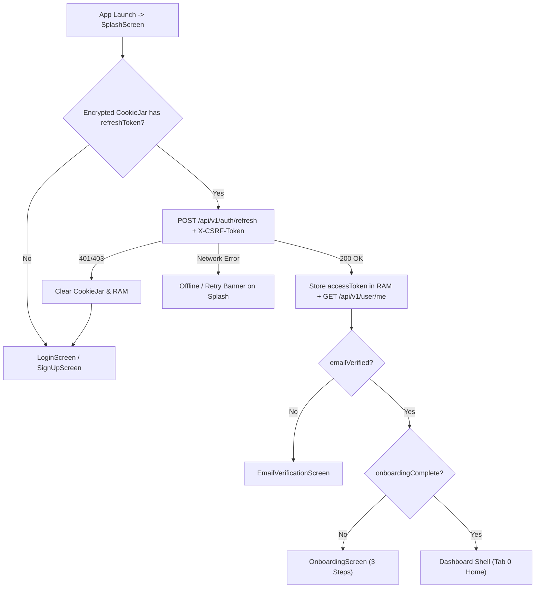
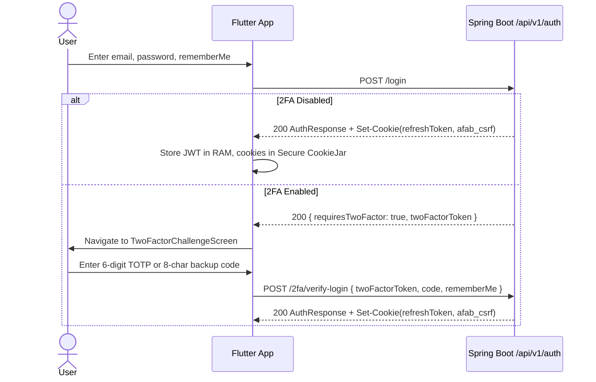
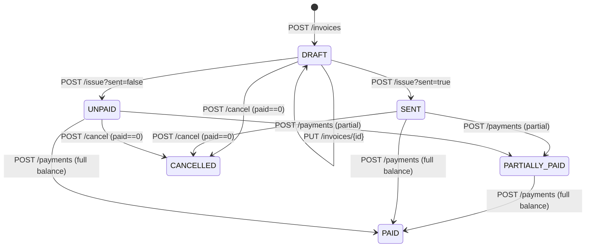

# 10 — User Flows & Navigation Diagrams

> End-to-end behavioral flows connecting AFAB Mobile screens, GoRouter guards, and Spring Boot APIs.

---

## 1. App Startup, Session Restoration & Auth Routing



---

## 2. Login + 2FA + Registration + Password Recovery



---

## 3. Single-Flight Token Refresh & Multi-Tenant Business Switch

```mermaid
sequenceDiagram
    participant UI as Multiple Widgets
    participant Dio as AuthInterceptor
    participant Lock as Single-Flight Completer
    participant API as Backend API
    UI->>Dio: Request A & Request B (expired JWT)
    Dio->>API: Requests A & B -> 401 UNAUTHORIZED
    Dio->>Lock: Acquire inFlightRefresh (Request A starts, B awaits)
    Lock->>API: POST /auth/refresh (Cookie: refreshToken + afab_csrf; Header: X-CSRF-Token)
    API-->>Lock: 200 New accessToken + Rotated refreshToken cookie
    Lock-->>Dio: Complete(true)
    Dio->>API: Retry Request A & B with new Bearer token + X-Business-Id
```

**Business Switch Flow:**
1. User taps Business Switcher pill in AppBar → `BusinessSwitcherSheet` displays `GET /api/v1/business` with `editable` / `READ_ONLY` badges.
2. If user taps an `EDITABLE` business → `PUT /api/v1/business/{id}/switch` → update `activeBusinessIdProvider` → invalidate all Riverpod business-scoped providers → refetch Dashboard/current tab.
3. If user taps a `READ_ONLY` business → show `LockedBusinessDialog` explaining vault protection and offering navigation to `PlansAndSubscriptionScreen` / `BusinessAllocationSheet`.

---

## 4. Core Financial Flows

### 4.1 Transaction Lifecycle (Create / Edit / Duplicate / Split / Receipt)
- **Create / Duplicate:** `AddEditTransactionScreen` (`isEditing = false`) → optional live `GET /currencies/convert` FX quote preview → `POST /transactions` → refresh ledger & Dashboard. *(Fixes Web bug where Duplicate called `PUT` with empty ID.)*
- **Split:** `SplitTransactionScreen` → validates `sum(lines) == totalAmount` using `Decimal` → `POST /transactions` with `splitItems[]` (last child absorbs FX rounding residual on backend).
- **Receipt:** `TransactionDetailsScreen` → Camera/Gallery/PDF picker → compress image (`<= 1024px`) → `POST /receipts/transactions/{id}` → preview/download via `GET /receipts/{id}/content` (authenticated stream) or `share_plus`.

### 4.2 Invoice Lifecycle & Idempotent Payment Recording

- `RecordPaymentSheet` generates one `Uuid().v4()` `Idempotency-Key` per sheet session (reused on network retry), creating a 1:1 cash-basis `INCOME` transaction with immutable FX snapshot on the backend.

### 4.3 AI Copilot Streaming & Action Approval Flow
1. Optional attachment staging: pick/capture file → `POST /ai/attachments/stage` (max 3, `<= 10 MB`) → chip preview via `GET /ai/attachments/{id}/preview`.
2. Send turn: `POST /ai/chat/stream` → SSE frames `status` → `thought` (deep mode) → `tool_start`/`tool_done` → `delta` (streaming Markdown) → optional `replace` → `done` (with `charts[]`, `actionDrafts[]`, `evidence[]`, `suggestedFollowUps[]`).
3. Human-in-the-Loop Drafts: User edits/reviews inline draft card → taps Approve → calls `POST /ai/actions/approve-{transaction|invoice|budget|memory}` (promotes staged receipt if present) or `PATCH /ai/messages/{msgId}/drafts/{draftId}/dismiss`.

### 4.4 Stripe Billing & Return Flow
1. Upgrade without active Stripe sub → `POST /billing/checkout` → open returned `url` via `flutter_custom_tabs` (`CustomTabs` / `SFSafariViewController`).
2. User completes Stripe Checkout → Stripe redirects to `{frontendUrl}/{locale}/dashboard/settings/subscription?checkout=success&session_id=...` → App Links / Universal Links deep-links back into app (or Custom Tab closes on redirect) → app calls `POST /billing/checkout/verify` → refreshes `SubscriptionSnapshot` & `BusinessAllocations`.
3. Direct Upgrade (existing Stripe sub) / Downgrade / Cancel / Resume → pure JSON APIs (`POST /billing/upgrade`, `/downgrade`, `/cancel`, `/resume`) with zero browser handoff.
