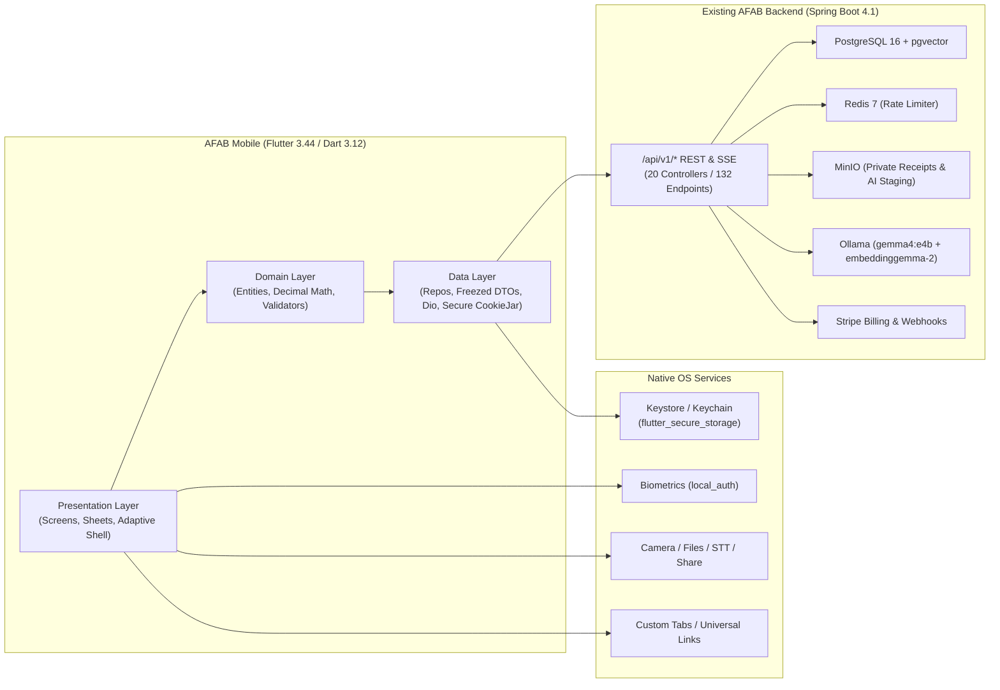

# System Architecture — AFAB Mobile

> **Architecture Style:** Feature-First Clean Architecture backed by Riverpod 3.x state graph, GoRouter declarative navigation, and existing Spring Boot 4.1 REST/SSE APIs.

---

## 1. High-Level System Context

---

## 2. Core Architectural Layers

1. **Application Shell (`lib/app/`):**
   - `AfabApp`: Wires `MaterialApp.router` with dynamic `AppearanceThemeBuilder` (`ThemeMode`, `ThemeData`, `AfabColors`, `google_fonts`), `AppLocalizations` (`en`/`ar`), and global error/plan-limit listeners.
   - `AppRouter`: `GoRouter` managing unauthenticated routes, onboarding/verification gates, `StatefulShellRoute.indexedStack` (5 phone tabs / 13 tablet rail destinations), and out-of-shell `/maintenance` & `/not-found`.
2. **Core Infrastructure (`lib/core/`):**
   - **Networking:** Single `Dio` instance + dedicated `sseDio` (130s receive timeout), `CookieManager` (`PersistCookieJar` → `EncryptedCookieStorage`), `AuthInterceptor` (single-flight refresh), `TenantInterceptor` (`X-Business-Id`), `ApiErrorInterceptor` (`400`/`401`/`403 PLAN_LIMIT_REACHED`/`403 BUSINESS_READ_ONLY`/`429`/`503`).
   - **Money & Precision:** `Decimal` wrappers (`NUMERIC(19,4)` amounts, `NUMERIC(19,6)` FX rates), ISO-4217 minor-unit display (`3` decimals for `TND`/`KWD`/`BHD`/`OMR`, `0` for `JPY`, `2` default), `US`/`EU`/`SI`/`DOT`/`RAW` formatting.
   - **Localization:** `gen-l10n` (`app_en.arb`, `app_ar.arb`), RTL directionality, Western digits (`0-9`) enforcement, per-message script directionality for AI Copilot.
3. **Shared UI Kit (`lib/shared/`):**
   - Canonical AFAB components (`AfabCard`, `AfabKpiCard`, `MoneyText`, `AfabStatusBadge`, `AfabBottomSheet`, `AfabLoader`, `AfabEmptyState`, `FlChart` wrappers) eliminating widget duplication across features.
4. **Feature Modules (`lib/features/<feature>/`):**
   - Each module encapsulates `data/`, `domain/`, and `presentation/`, isolating DTO parsing, backend endpoints, and Riverpod controllers from shared infrastructure.
